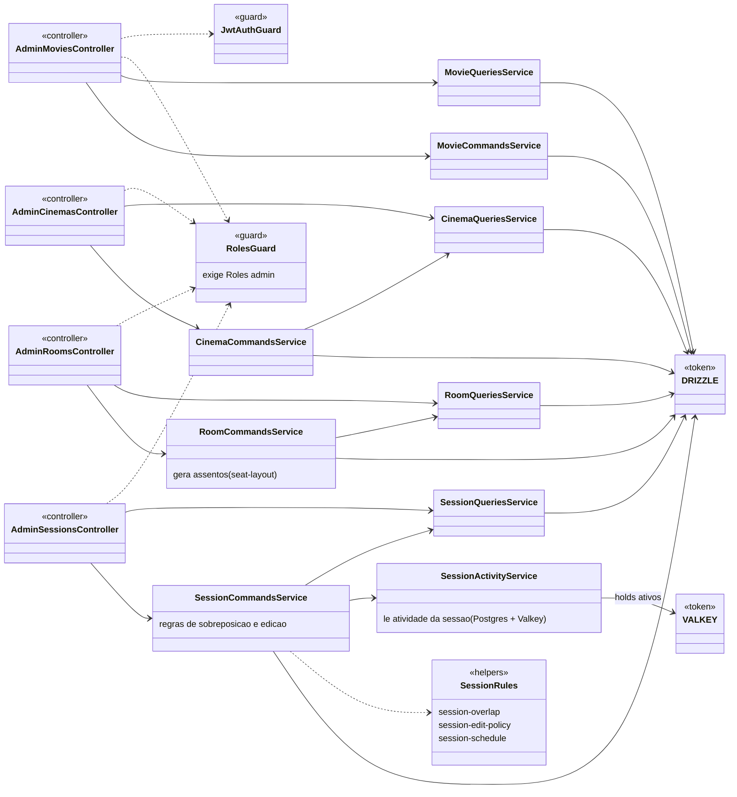

# Classes: Painel admin (CRUD + RolesGuard)

Módulo `AdminModule` (`apps/api/src/admin/`): back office em `/admin/*` com CQRS light (commands e queries separados por recurso, sem event store). Spec: [`spec.md`](./spec.md). O estorno do admin está em [`../refund/class.md`](../refund/class.md).

## Notas

- Todos os controllers admin usam `@UseGuards(JwtAuthGuard, RolesGuard)` e `@Roles("admin")` (o `RolesGuard` precisa rodar depois do `JwtAuthGuard`).
- `AdminModule` importa `AuthTokenModule` (guards) e `RefundModule` (`AdminRefundsController` + `RefundReviewQueriesService`).
- Não existe cache de catálogo, então as escritas do painel não invalidam nada.
