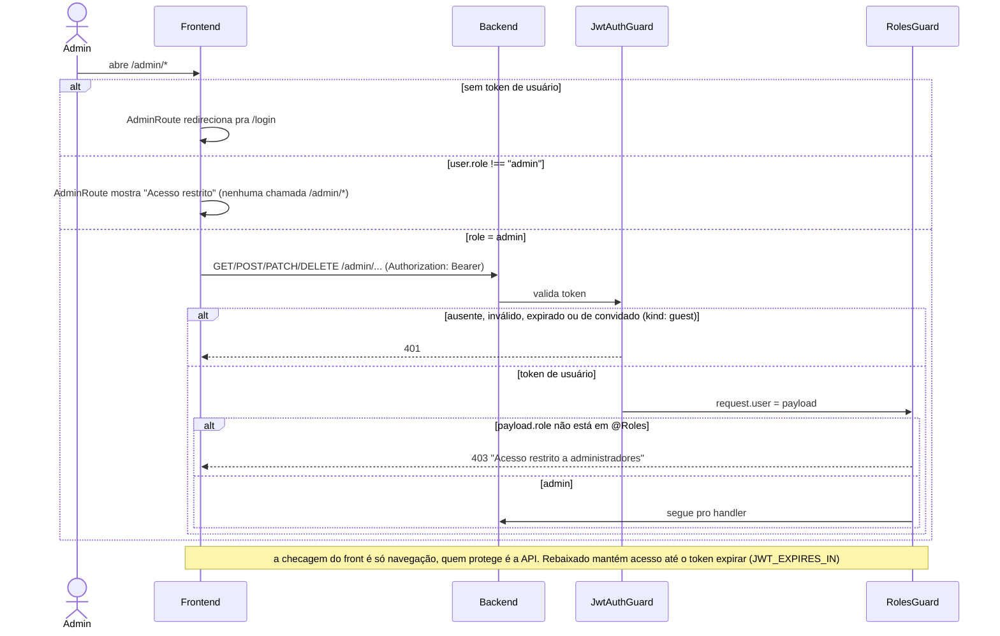
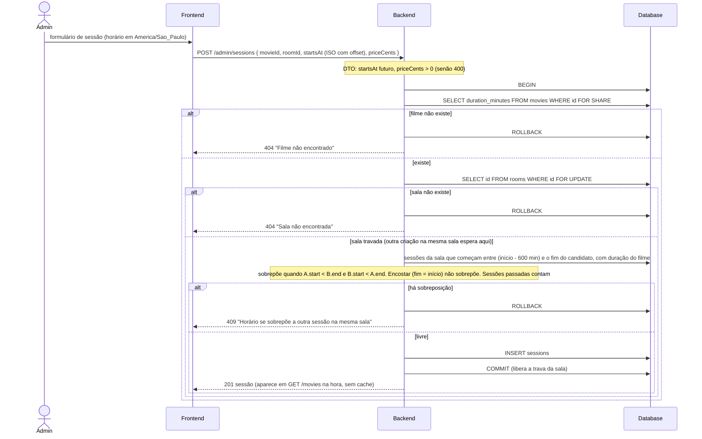
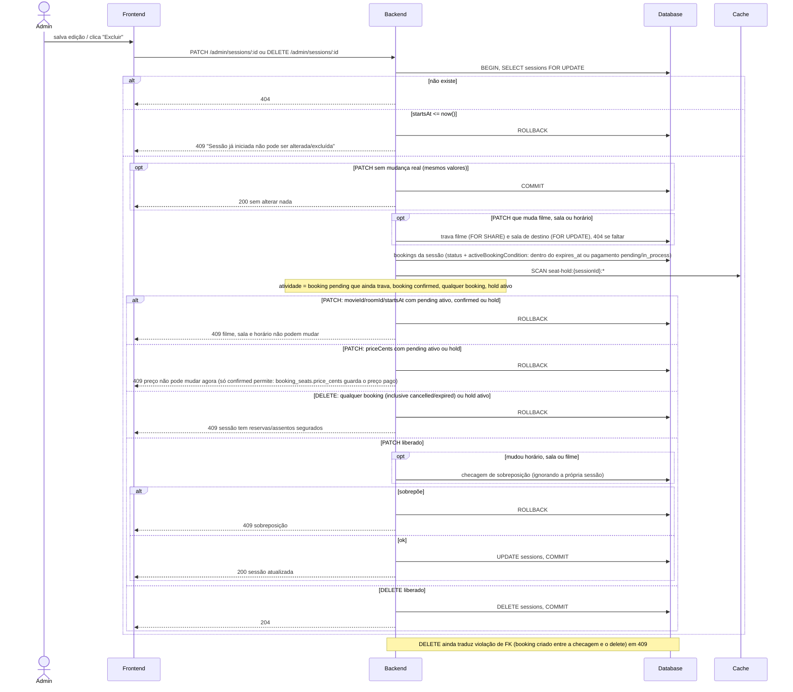
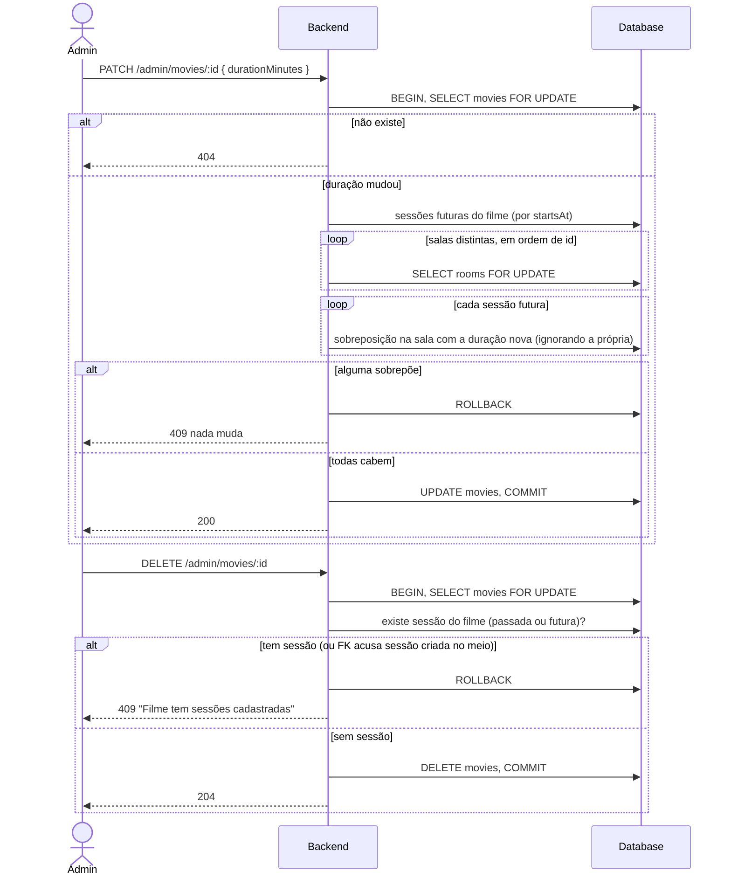
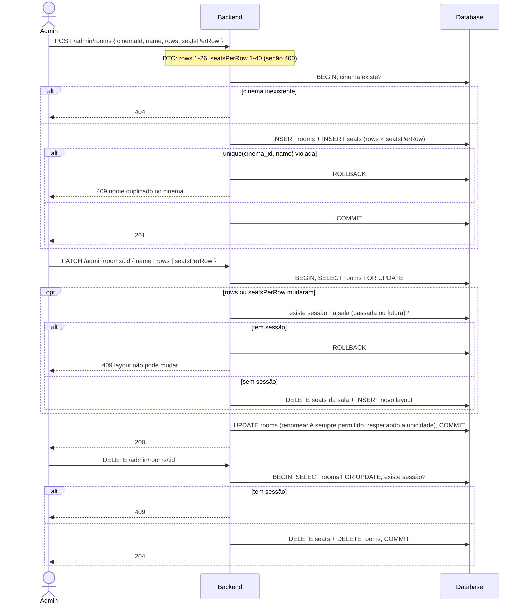

# Sequence: Painel admin (CRUD de filmes, salas e sessões)

Autorização por papel em `/admin/*` e as regras de escrita que dependem de trava no banco: criação/edição de sessão com checagem de sobreposição (trava `FOR UPDATE` na sala), duração de filme revalidando sessões futuras e layout/exclusão de sala. Spec: [`spec.md`](./spec.md).

Cobre `AdminRoute`/páginas de `/admin` (Frontend) → `Admin*Controller` + `RolesGuard` (Backend) → Postgres (Database) e Valkey (Cache, só leitura de holds).

## 1. Autorização (JwtAuthGuard + RolesGuard)

Todo controller do `AdminModule` usa `@UseGuards(JwtAuthGuard, RolesGuard)` com `@Roles("admin")`. O papel vem do token, sem consulta ao banco por requisição.

## 2. Criar sessão (sobreposição + FOR UPDATE na sala)

`SessionCommandsService.create`: uma transação trava o filme (`FOR SHARE`, a duração não muda no meio da checagem) e a sala (`FOR UPDATE`) antes de ler as sessões dela. Duas criações concorrentes na mesma sala rodam uma depois da outra, e a segunda enxerga a primeira.

## 3. Editar e excluir sessão (atividade de compra)

`SessionCommandsService.update`/`delete`: trava a sessão (`FOR UPDATE`, o que também segura um `INSERT` de booking concorrente pela FK), confere se já começou, lê a atividade (bookings no Postgres, holds no Valkey) e só então aplica. Ordem de trava sempre sessão → filme → sala, pra duas transações admin não se esperarem em ciclo.

## 4. Filme: duração revalida sessões futuras; exclusão

`MovieCommandsService`: mudar `durationMinutes` trava o filme (`FOR UPDATE`) e as salas das sessões futuras dele (em ordem de id, sem deadlock), e revalida cada sessão com a duração nova. Filme com qualquer sessão (passada ou futura) não pode ser excluído.

## 5. Sala: gerar assentos, mudar layout e excluir

`RoomCommandsService`: criar sala insere a sala e `rows × seatsPerRow` assentos (`A1`..) na mesma transação. Mudar layout ou excluir só vale sem nenhuma sessão, porque assento é referenciado por `booking_seats` e por chaves de hold.

## Referências

- `apps/web/src/lib/AdminRoute.tsx`, `apps/web/src/features/admin/`
- `apps/api/src/auth/roles.guard.ts`, `apps/api/src/auth/roles.decorator.ts`, `apps/api/src/auth/jwt-auth.guard.ts`
- `apps/api/src/admin/sessions/session-commands.service.ts`, `session-activity.service.ts`, `session-edit-policy.ts`, `session-schedule.ts`, `session-overlap.ts`
- `apps/api/src/admin/shared/row-locks.ts` (`lockSession`, `lockMovie`, `lockRoom`)
- `apps/api/src/admin/movies/movie-commands.service.ts`, `apps/api/src/admin/rooms/room-commands.service.ts`, `apps/api/src/admin/rooms/seat-layout.ts`
- `apps/api/src/booking/booking-lock.ts` (`activeBookingCondition`)
