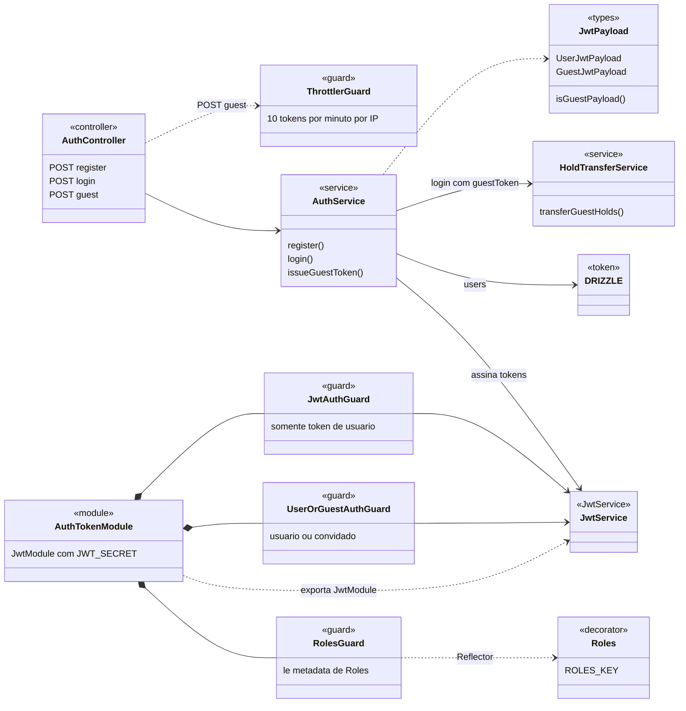

# Classes: Autenticação (login, registro e convidado)

Módulos `AuthModule` e `AuthTokenModule` (`apps/api/src/auth/`). Convidado: JWT `kind: "guest"` de 2h, só pra segurar assento antes do login. Spec: [`../public-catalog-login-gate/spec.md`](../public-catalog-login-gate/spec.md).

## Notas

- `AuthModule` importa `AuthTokenModule`, `SeatingModule` e `ThrottlerModule`, e reexporta `AuthTokenModule`.
- `AuthTokenModule` foi separado de `AuthModule` pra `SeatingModule` (e `RefundModule`/`AdminModule`) usarem os guards sem importar `AuthModule`, que evita ciclo (`AuthModule` -> `SeatingModule` por causa da transferência de holds).
- Token de convidado é recusado (401) em booking, pagamento e ingressos: esses controllers usam `JwtAuthGuard`; só `SeatingController` usa `UserOrGuestAuthGuard`.
