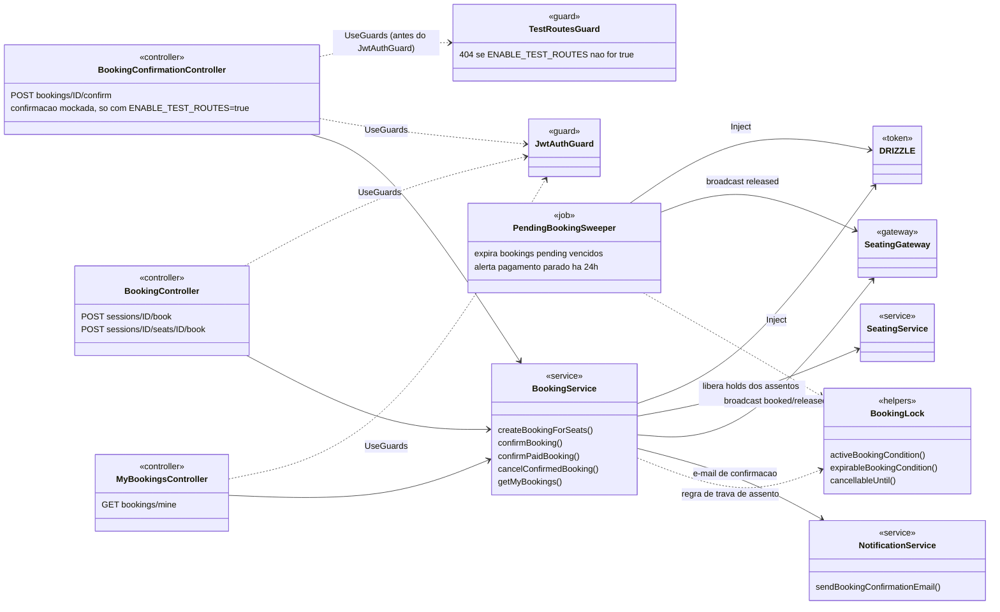

# Classes: Reserva de assentos (booking)

Módulo `BookingModule` (`apps/api/src/booking/`): cria a reserva `pending` a partir dos assentos segurados, confirma, cancela (parte da transação do estorno) e expira reservas vencidas. Fluxo em [`sequence.md`](./sequence.md).

## Notas

- `BookingModule` importa `AuthModule`, `SeatingModule` e `NotificationModule`; exporta `BookingService` (usado por `PaymentModule` e `RefundModule`).
- `cancelConfirmedBooking` recebe a transação de quem chama (o `RefundService`), por isso o cancelamento e o registro do estorno ficam atômicos.
- `BookingConfirmationController` (`POST /bookings/:id/confirm`) é a confirmação mockada, sem pagamento: o `TestRoutesGuard` roda antes do `JwtAuthGuard` e responde 404, como se a rota não existisse, a menos que `ENABLE_TEST_ROUTES=true` (lido a cada request). Spec: [`../test-routes/spec.md`](../test-routes/spec.md).
- Consistência de assento vem do Postgres (`unique (session_id, seat_id)` em `booking_seats`); o hold no Valkey é só temporário. Ver [`../../schema.md`](../../schema.md).
