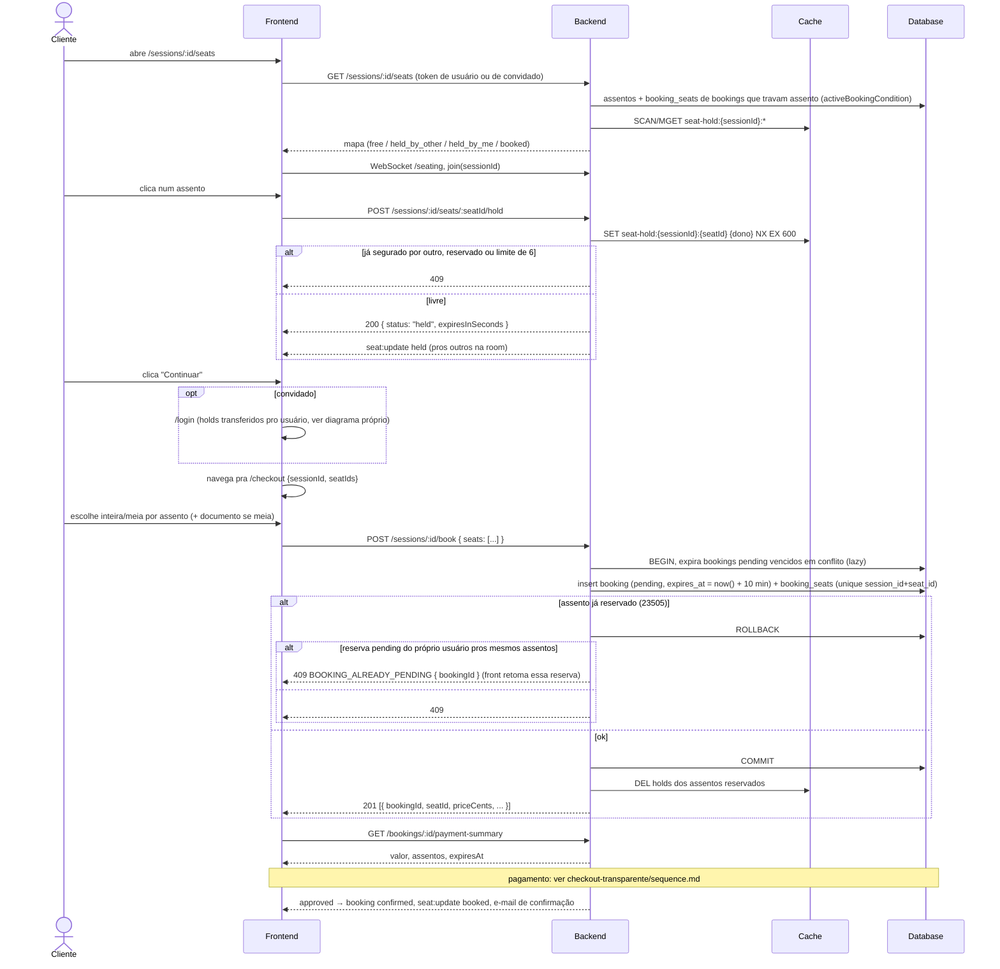

# Sequence: Reserva de assentos (booking)

Fluxo de ponta a ponta hoje: visitante (convidado ou logado) abre o mapa de assentos, segura assentos no Valkey, faz login ao avançar pro pagamento, cria a reserva no checkout e paga. Cobre `SessionSeatsPage`/`CheckoutPage` (Frontend) → `SeatingController`/`BookingController`/`PaymentController` (Backend) → Valkey (Cache) → Postgres (Database).

Detalhes em diagramas próprios:

- convidado segurando assento e transferência no login: [`../public-catalog-login-gate/sequence.md`](../public-catalog-login-gate/sequence.md)
- tentativa de pagamento e webhook: [`../checkout-transparente/sequence.md`](../checkout-transparente/sequence.md)

## Fora do fluxo feliz

- **Token expirado** (`401` em rota de usuário): front limpa o token e redireciona pra `/login`.
- **Hold expira** (TTL de 600s): o Valkey emite keyspace notification e o `HoldExpiryListener` faz broadcast `released`.
- **Desistência**: "← Voltar" em `SessionSeatsPage`/`CheckoutPage` abre confirmação; confirmar chama `DELETE /sessions/:id/holds` (solta todos os holds do dono na sessão) e volta pro catálogo. Desmarcar um assento chama `DELETE /sessions/:id/seats/:seatId/hold`.
- **Reserva expira sem pagamento**: booking `pending` passado do `expires_at` sem pagamento `pending`/`in_process` vira `expired`, os `booking_seats` são apagados e sai broadcast `released` — pelo `PendingBookingSweeper` (a cada 60s) ou de forma lazy na próxima reserva em conflito. Pagamento depois disso responde `409 BOOKING_EXPIRED` e o checkout mostra o aviso com volta ao mapa. Spec: `docs/flows/pending-booking-expiry/spec.md`.
- **Cancelamento pelo cliente** (`POST /bookings/:id/cancel`, em "Meus ingressos"): booking `cancelled`, assentos liberados com broadcast `released`.

## Referências

- `apps/web/src/features/seating/SessionSeatsPage.tsx`, `apps/web/src/features/checkout/CheckoutPage.tsx`
- `apps/api/src/seating/seating.controller.ts`, `apps/api/src/seating/seating.service.ts`, `apps/api/src/seating/hold-expiry.listener.ts`
- `apps/api/src/booking/booking.controller.ts`, `apps/api/src/booking/booking.service.ts`, `apps/api/src/booking/booking-lock.ts`, `apps/api/src/booking/pending-booking.sweeper.ts`
- `apps/api/src/payment/payment.controller.ts`
