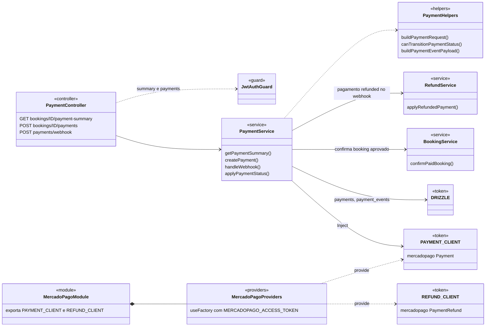

# Classes: Pagamento (Checkout Transparente) e MercadoPagoModule

Módulos `PaymentModule` (`apps/api/src/payment/`) e `MercadoPagoModule` (`apps/api/src/mercadopago/`). Cada tentativa vira uma linha em `payments` e eventos append-only em `payment_events`. Spec: [`spec.md`](./spec.md); fluxo em [`sequence.md`](./sequence.md).

## Notas

- `PaymentModule` importa `AuthModule`, `BookingModule`, `MercadoPagoModule` e `RefundModule`.
- `MercadoPagoModule` existe pra `PaymentModule` e `RefundModule` compartilharem os clientes do SDK sem um importar o outro (`RefundModule` não importa `PaymentModule`).
- `POST /payments/webhook` é público; o webhook nunca confia no corpo, ele busca o pagamento no Mercado Pago pelo id.
