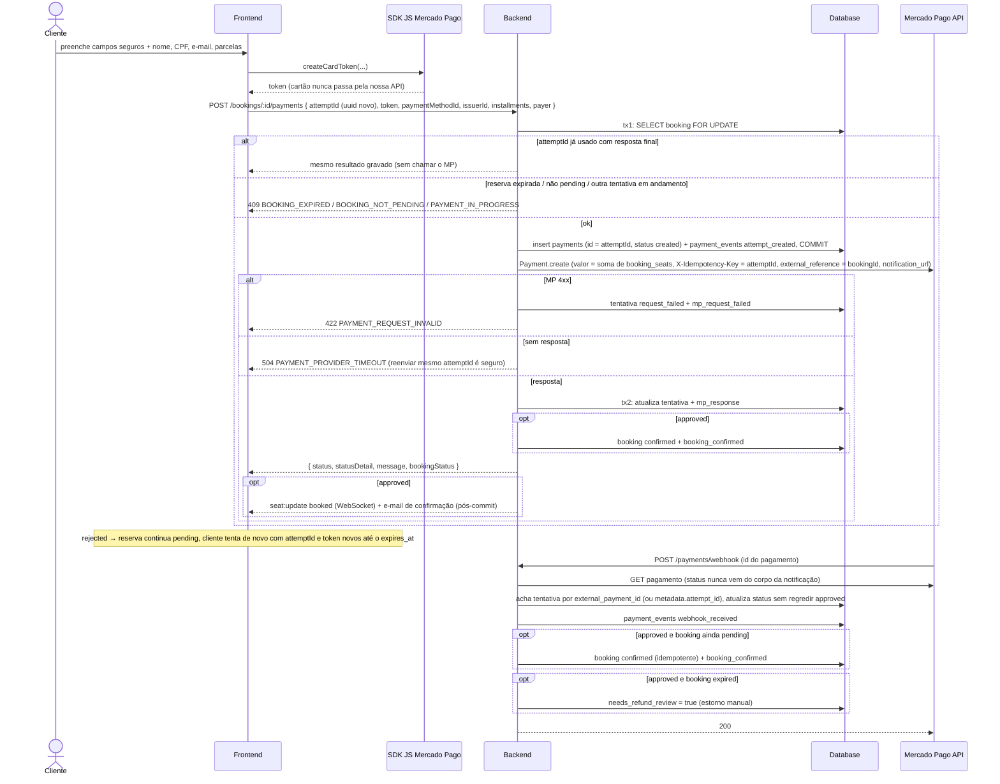

# Sequence: Tentativa de pagamento (Checkout Transparente) e webhook

Uma tentativa de pagamento com cartão numa reserva `pending`, e a notificação posterior do Mercado Pago. Spec: [`spec.md`](./spec.md).

## Referências

- `apps/web/src/features/checkout/CheckoutPage.tsx`, `apps/web/src/features/checkout/api.ts`, `apps/web/src/features/checkout/mercadopago.ts`
- `apps/api/src/payment/payment.controller.ts`, `apps/api/src/payment/payment.service.ts`, `apps/api/src/payment/payment.helpers.ts`
- `apps/api/src/booking/booking.service.ts` (`confirmPaidBooking`)
