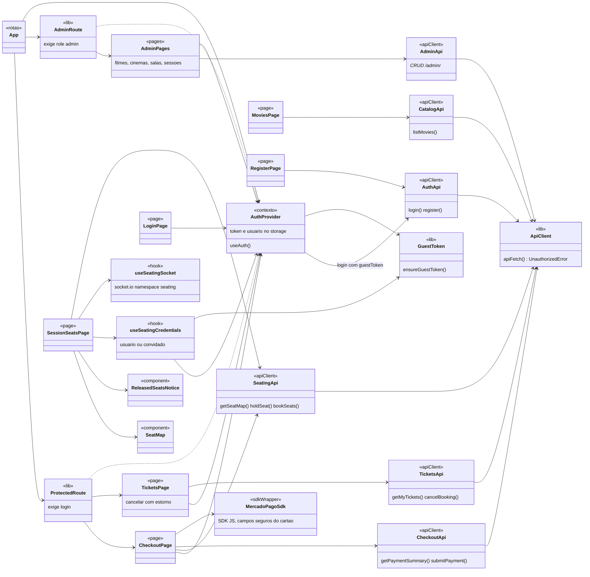

# Classes/componentes: Frontend (`apps/web/src`)

Visão por feature (`features/*`) do front React: páginas, hooks, contexto e clients de API. Só as dependências relevantes; as telas do admin (`features/admin`) aparecem agrupadas.

## Notas

- Catálogo e mapa de assentos são públicos; o visitante segura assento como convidado (token de `POST /auth/guest`, guardado por `GuestToken`) e o login transfere os holds (`AuthProvider` envia o `guestToken` no login).
- `ProtectedRoute` cobre `/checkout` e `/tickets`; `AdminRoute` cobre `/admin/*`.
- `CheckoutPage` usa o SDK JS do Mercado Pago só pra tokenizar o cartão; o pagamento em si passa pelo back (`CheckoutApi`).
