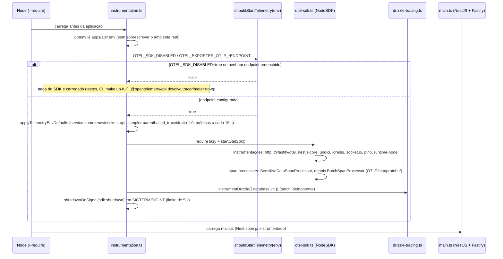
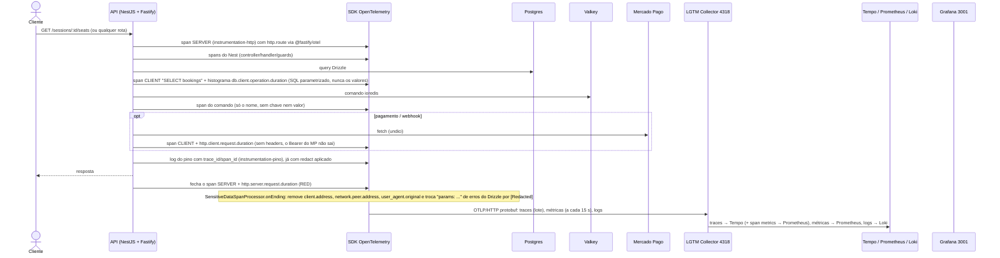
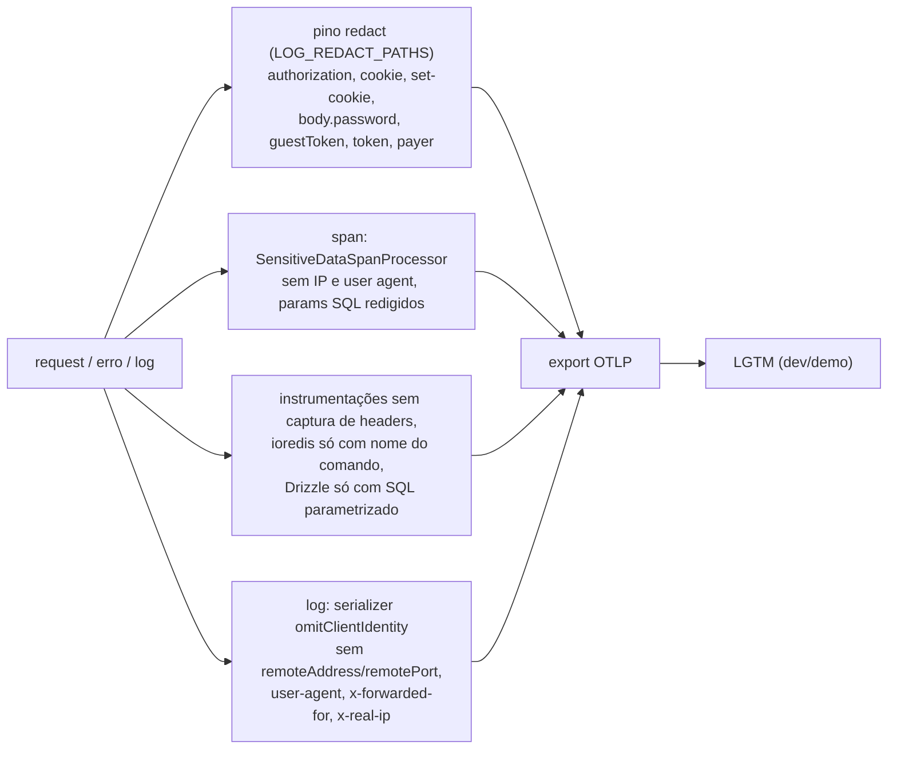
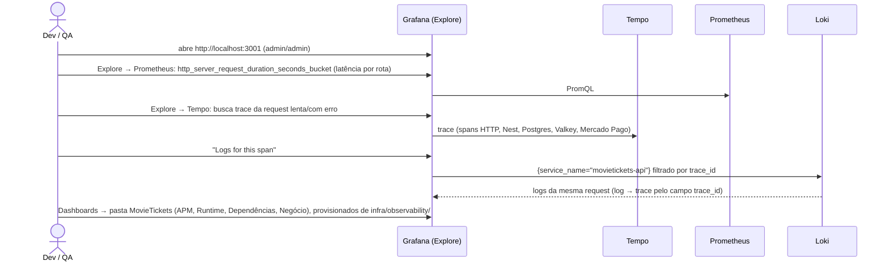
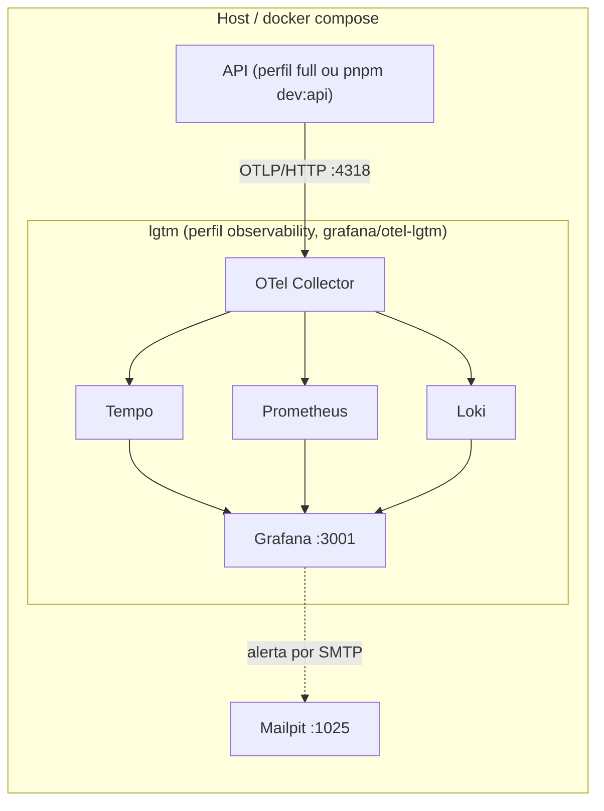
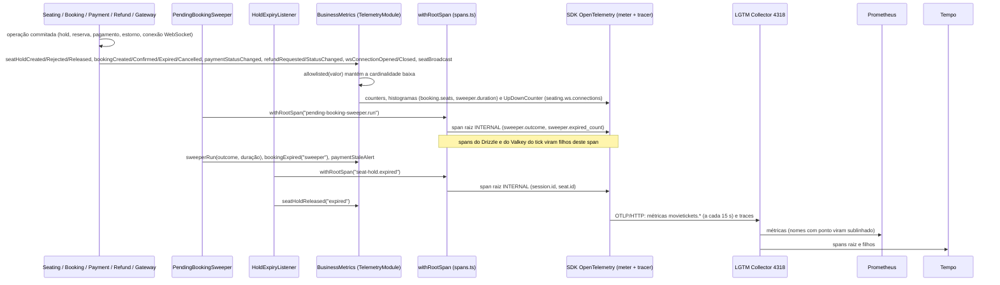
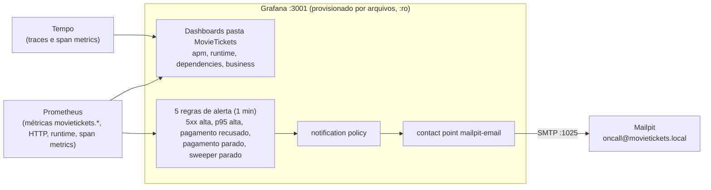

# Sequence: Observabilidade (request → span/métrica/log → OTLP → LGTM → Grafana)

Caminho da telemetria da API até o Grafana: boot condicional do SDK, o que cada request gera (span, métrica, log correlacionado), a limpeza de dados sensíveis antes do export e a navegação trace → log no Grafana. Spec: [`spec.md`](./spec.md).

Estado da implementação: o que está nos diagramas abaixo (bootstrap, instrumentações, patch do Drizzle, remoção de dados pessoais, redact de logs, flush no shutdown e o container `lgtm`) está **implementado**. Também estão **implementados** (PR #92): as métricas de negócio (`BusinessMetrics`, `movietickets.*`), os spans raiz manuais do sweeper e do listener de expiração de hold, e os dashboards e alertas provisionados em `infra/observability/` (seções 6 e 7). Nada neste documento está mais marcado como planejado.

## 1. Boot (só liga com endpoint OTLP)

`apps/api/src/instrumentation.ts` é carregado por `node --require ./dist/instrumentation.js` **antes** do `main.js` (Dockerfile, `start:dev`, `start:prod`), pra as instrumentações enxergarem `http`, fastify, ioredis e pino antes do Nest requerê-los.

## 2. Uma request: span, métrica e log até o Grafana

Também alimentam o mesmo caminho, sem request: `instrumentation-runtime-node` (event loop, heap, GC), `instrumentation-socket.io` (eventos do `/seating`) e o log `warn`/`error` do sweeper e do webhook. As métricas `movietickets.*` (`BusinessMetrics`, emitidas depois do commit) e os spans raiz manuais `pending-booking-sweeper.run` e `seat-hold.expired` seguem o mesmo caminho e estão na seção 6.

## 3. Privacidade antes de sair do processo

O `redact` do pino roda na serialização do registro, então o log que a instrumentação envia ao Loki também já sai sem esses campos. IP e user agent do cliente não são mascarados nos logs, são **removidos** do `req` serializado por `omitClientIdentity` (`log-redaction.ts`, ligado em `serializers: { req }` no `LoggerModule`), então não aparecem nem no stdout nem no Loki.

## 4. Do trace ao log no Grafana

## 5. Topologia (docker compose)

No host, a API exporta pra `http://localhost:4318`; no container (`make up-full-obs`), pra `http://lgtm:4318` (`API_OTEL_EXPORTER_OTLP_ENDPOINT`). Sem o perfil `observability`, a variável fica vazia e o SDK não carrega.

## 6. Métricas de negócio e spans manuais

`TelemetryModule` (`@Global`) expõe `BusinessMetrics` (`apps/api/src/telemetry/business-metrics.ts`). O token `METER_PROVIDER` é resolvido por factory (`metrics.getMeterProvider()`) quando o Nest instancia o provider, depois do `instrumentation.ts` ter registrado o SDK. Cada método valida os atributos contra uma allowlist fechada (fora dela vira `other`) e nunca recebe id, e-mail ou texto livre. Os serviços chamam depois do commit; com a telemetria desligada o meter é no-op.

Instrumentos criados no construtor do `BusinessMetrics` (nunca em escopo de módulo, porque a API de métricas não tem proxy). Famílias: `seat_hold.*` (created, rejected, released, transferred), `booking.*` (created, seats, confirmed, expired, cancelled, refund_review_flagged), `payment.*` (attempt.created, status_changed, provider.errors, stale_alert), `sweeper.*` (runs, duration), `seating.ws.*` e `seating.broadcasts`, `notification.email` e `refund.*` (requested, status_changed). `PaymentService` também grava `payment.status` e `payment.status_detail` no span da request via `setActiveSpanAttributes`.

## 7. Dashboards e alertas provisionados

Arquivos: `infra/observability/grafana/dashboards/{apm,runtime,dependencies,business}.json` (uids `movietickets-apm|runtime|dependencies|business`, home do Grafana = APM), `provisioning/dashboards/movietickets.yaml` e `provisioning/alerting/{rules,notification-policies,contact-points}.yaml`. O `lgtm` monta esses caminhos como somente leitura. As regras: `mt-http-5xx-rate`, `mt-http-p95-latency`, `mt-payment-rejection-spike`, `mt-payment-stale` e `mt-sweeper-stopped` (esta alerta também sem dados).

## Referências

- `apps/api/src/instrumentation.ts`, `apps/api/src/telemetry/should-start-telemetry.ts`, `otel-sdk.ts`, `drizzle-tracing.ts`, `sensitive-data-span-processor.ts`, `log-redaction.ts`, `shutdown-on-signal.ts`
- `apps/api/src/telemetry/business-metrics.ts`, `spans.ts`, `telemetry.module.ts`; `infra/observability/grafana/**`
- `apps/api/src/app.module.ts` (`LoggerModule` com `redact: LOG_REDACT_PATHS`)
- `docker-compose.yml` (serviço `lgtm`), `Makefile` (`obs-up`, `obs-down`, `up-full-obs`), `README.md` (seção "Observabilidade")
- `apps/api/test/observability-smoke.e2e-spec.ts` (coletor OTLP falso)
