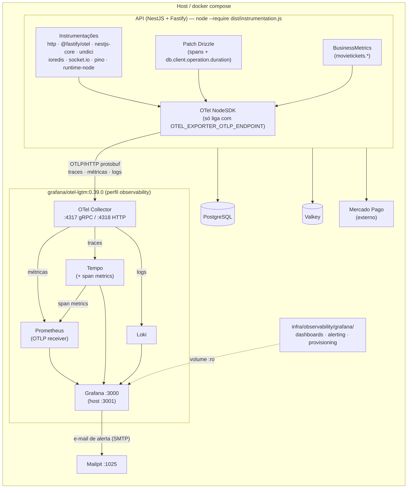

# Spec: Observabilidade da API (OpenTelemetry + Grafana LGTM)

> Os números de AC desta spec são locais à feature (`AC1`, `AC2`, ...) e não têm relação com nenhuma outra numeração externa.

## Contexto

Hoje a API (`apps/api`) só tem logs: `nestjs-pino` com `pino-http` (`apps/api/src/app.module.ts`), saída em stdout (`pino-pretty` fora de produção) e `redact` de `req.headers.authorization` e `req.body.password`. Não existe métrica, trace nem painel. Pra saber se o checkout está lento, se o Mercado Pago está recusando mais que o normal ou se o `PendingBookingSweeper` parou, o único caminho é ler log.

Esta spec instrumenta a API com OpenTelemetry (traces, métricas e logs correlacionados) e sobe um backend local de observabilidade num container só, `grafana/otel-lgtm` (OTel Collector + Prometheus + Tempo + Loki + Grafana), num perfil novo do docker compose (`observability`). Entram dashboards e alertas versionados no repo, como arquivos provisionados no Grafana.

O objetivo é demonstrável no ambiente local/demo (milestone Prova): rodar o fluxo de compra e ver no Grafana a latência por rota, a dependência (Postgres, Valkey, Mercado Pago), os números de negócio (holds, reservas, pagamentos) e ir de um trace pros logs dele.

## Escopo

- Bootstrap do OpenTelemetry Node SDK na API, carregado antes do Nest/Fastify, configurado por variáveis de ambiente e **desligado** quando não há endpoint configurado.
- Instrumentação automática: HTTP/Fastify, Nest (controllers/guards), `fetch` (chamadas ao Mercado Pago), ioredis (Valkey), Socket.io, pino (correlação + envio de logs), runtime Node (event loop, heap, GC).
- Instrumentação manual do Postgres (Drizzle sobre `postgres`/postgres.js), porque não existe instrumentação oficial pra esse driver (ver "Postgres: postgres.js não tem instrumentação oficial").
- Spans manuais pro que roda fora de request: tick do `PendingBookingSweeper` e expiração de hold (`HoldExpiryListener`).
- Métricas de negócio customizadas (holds, reservas, pagamentos, sweeper, WebSocket, e-mail; estornos dependem da spec de estornos).
- Serviço `lgtm` (`grafana/otel-lgtm:0.39.0`) no `docker-compose.yml` sob o perfil `observability`, com dashboards, alertas e contact point provisionados de `infra/observability/`.
- Targets no `Makefile` e seção no `README.md`.
- Regras de privacidade: o que nunca pode ir pra log, atributo de span ou atributo de métrica.

## Fora de escopo

- RUM/observabilidade do front (`apps/web`): sem SDK de browser, sem Web Vitals, sem propagação de trace a partir do navegador.
- Ambiente de produção real (Grafana Cloud, cluster, HA, retenção longa). O `grafana/otel-lgtm` é declaradamente pra dev/demo/teste.
- Profiling contínuo (Pyroscope vem na imagem, mas não é configurado nem usado).
- OBI/eBPF (opcional da imagem, não habilitado).
- Instrumentar os scripts `db:migrate`/`db:seed` (`tsx`), o Drizzle Studio e o container do `web`.
- Trocar o driver do banco (`postgres` → `pg`) só pra ganhar instrumentação automática.
- SLOs formais / error budget. Os alertas daqui são limiares simples.
- Alertas com roteamento real (PagerDuty, Slack). Notificação só por e-mail no Mailpit local (ver D4).

## Dependências e relação com outras specs

- `docs/flows/pending-booking-expiry/spec.md`: sweeper, `stale_payment_alerted_at` e `needs_refund_review` são as fontes das métricas `movietickets.sweeper.*`, `movietickets.payment.stale_alert` e `movietickets.booking.refund_review_flagged`.
- `docs/flows/checkout-transparente/spec.md`: status de tentativa (`payments.status`) e origem (resposta síncrona x webhook) das métricas `movietickets.payment.*`.
- `docs/flows/refund/spec.md` (estorno de pagamento): fonte das métricas `movietickets.refund.*` e de `movietickets.booking.cancelled`. Quando esta spec foi escrita ela ainda não estava na `main` (D9); com ela publicada, nome, enum de status e pontos de emissão foram fixados na tabela de métricas abaixo (ver "Notas da implementação (métricas, dashboards e alertas)").

## Fatos verificados

Verificados em 2026-11-20 contra o registry do npm, o código-fonte publicado (unpkg) e os repositórios oficiais. O que não deu pra confirmar está em "Fatos não verificados".

### Como a API é construída e roda

- `apps/api/tsconfig.json` usa `"module": "commonjs"` e o build é `nest build` com builder SWC (`apps/api/nest-cli.json`). A saída em `dist/` é **CommonJS**, então o carregamento antecipado usa `--require` (não precisa de `--import` nem de loader hook ESM). Ref: <https://opentelemetry.io/docs/languages/js/getting-started/nodejs/>.
- Produção/container: `apps/api/Dockerfile`, estágio `runtime`, `CMD ... node dist/main.js` (depois de `migrate` e `seed`). Imagem `node:24-alpine`.
- Dev: `pnpm dev:api` → `nest start --watch`. O `@nestjs/cli` 11.0.24 aceita `-e, --exec [binary]` ("Binary to run (default: node)") — conferido em `commands/start.command.js` do pacote instalado.
- Variáveis de ambiente: em dev vêm de `apps/api/.env`, lido pelo `ConfigModule.forRoot()` **dentro** do bootstrap do Nest. Um `instrumentation.ts` carregado por `--require` roda antes disso, então precisa carregar o `.env` sozinho (`dotenv` 16.6.1 já é dependência da API).

### Postgres: postgres.js não tem instrumentação oficial

- A API usa `drizzle-orm/postgres-js` com o driver `postgres` 3.4.9 (`apps/api/src/db/drizzle.module.ts`), **não** `pg`.
- `@opentelemetry/instrumentation-pg` cobre só `pg` (node-postgres), versões `>=8 <9`. Ref: <https://www.npmjs.com/package/@opentelemetry/instrumentation-pg>.
- Não há instrumentação de postgres.js no `opentelemetry-js-contrib` (busca no npm e no repositório). Existe um pacote de terceiro, `otel-instrumentation-postgres` 1.0.0: release única (2025-07-13), ~38 downloads/semana, depende de `@opentelemetry/instrumentation ^0.202.0` (geração incompatível com o SDK 3.x escolhido aqui). Descartado.
- O Drizzle 0.45.2 tem um `tracer` interno (`drizzle-orm/tracing.js`) que abre spans `drizzle.execute`/`drizzle.driver.execute`, mas a variável `otel` **nunca é atribuída** nessa versão, então é sempre no-op. E se fosse ligado, grava `drizzle.query.params` (os valores dos parâmetros) no span, o que fere a regra de privacidade desta spec. Conferido no código instalado (`tracing.js` e `postgres-js/session.js`).
- No Drizzle 0.45.2 com postgres.js, toda query do query builder passa por `PostgresJsPreparedQuery.prototype.execute(placeholderValues)` (async, resolve com o resultado completo; `this.queryString` tem o SQL parametrizado com `$1, $2...`). Transações passam por `PostgresJsSession.prototype.transaction` (`client.begin`) e savepoints por `PostgresJsTransaction.prototype.transaction`. As duas classes são exportadas por `drizzle-orm/postgres-js`. Conferido em `postgres-js/session.js`.
- O `DrizzleLogger.logQuery(query, params)` é chamado **antes** da execução e não recebe duração nem erro, então não serve pra medir latência.

### Instrumentações e versões

- `@opentelemetry/instrumentation-fastify` está **deprecated** ("Deprecated in favor of @fastify/otel, maintained by the Fastify authors"). Ref: <https://www.npmjs.com/package/@opentelemetry/instrumentation-fastify>.
- `@fastify/otel` 1.x: "Requires Node.js >=22.15.0, OpenTelemetry API 1.10.x and SDK 3.x. Use SDK-generation 0.300.x packages". Aceita `registerOnInitialization: true` (registra via `diagnostics_channel` quando a instância Fastify é criada, sem precisar de acesso ao `app` antes das rotas) e `ignorePaths`/`requestHook`. Ele preenche o `rpcMetadata.route` do contexto HTTP com `request.routeOptions.url`, o que faz a métrica `http.server.request.duration` da instrumentação HTTP sair com `http.route` em formato de template (`/bookings/:id/payments`), não com o id real. Conferido em `index.js` do 1.0.1. Ref: <https://github.com/fastify/otel>.
- `@opentelemetry/instrumentation-http` 0.300.0 emite `http.server.request.duration` e `http.client.request.duration` (convenção estável) por padrão; o opt-in `OTEL_SEMCONV_STABILITY_OPT_IN` só existia até a 0.220.0. Ref: README do pacote e <https://opentelemetry.io/docs/specs/semconv/http/http-metrics/>.
- `@opentelemetry/instrumentation-ioredis` 0.72.0: suporta `ioredis >=2.0.0 <7` (a API usa 6.0.0). Opções `dbStatementSerializer` e `requireParentSpan` (padrão `true`: comando sem span pai não vira span).
- `@opentelemetry/instrumentation-pino` 0.70.0: suporta `pino >=5.14.0 <11` (a API usa 10.3.1). Faz "log correlation" (adiciona `trace_id`, `span_id`, `trace_flags` no registro dentro de um span ativo) e "log sending" (destino extra que manda o registro pro Logs SDK; no-op se não houver LoggerProvider).
- `@opentelemetry/instrumentation-socket.io` 0.71.0: suporta `socket.io >=2.0.0 <5` (a API usa 4.8.4).
- `@opentelemetry/instrumentation-nestjs-core` 0.71.0: suporta `@nestjs/core >=4.0.0 <12` (a API usa 11.2.3).
- `@opentelemetry/instrumentation-runtime-node` 0.37.0: Node `>=22.15.0`; emite `nodejs.eventloop.delay.{min,max,mean,stddev,p50,p90,p99}`, `nodejs.eventloop.utilization`, `nodejs.eventloop.time`, `v8js.gc.duration`, `v8js.memory.heap.used`, `v8js.memory.heap.space.*`, `v8js.resource.active`. Ref: <https://opentelemetry.io/docs/specs/semconv/runtime/>.
- O SDK do Mercado Pago (`mercadopago` 3.6.1) não tem dependências: usa o `fetch` global do Node (undici). A instrumentação de `fetch` é `@opentelemetry/instrumentation-undici`.
- `@opentelemetry/sdk-node` 0.300.0: `OTEL_SDK_DISABLED=true` desliga o SDK; exporters escolhidos por `OTEL_TRACES_EXPORTER`/`OTEL_METRICS_EXPORTER`/`OTEL_LOGS_EXPORTER` (padrão `otlp`; `none` desliga; métricas aceitam `prometheus`); `OTEL_METRIC_EXPORT_INTERVAL` padrão 60000 ms. Ref: README do pacote e <https://opentelemetry.io/docs/languages/sdk-configuration/general/>.
- `@opentelemetry/sdk-trace-base` foi deprecated em favor de `@opentelemetry/sdk-trace` na geração 3.x.
- A API de métricas (`@opentelemetry/api` 1.10.0, `metrics.getMeter`) **não tem proxy**: se o `getMeter` for chamado antes do SDK registrar o MeterProvider global, o meter é no-op pra sempre. (Traces têm `ProxyTracerProvider`, métricas não.) Conferido em `dist/api/metrics.cjs`. Consequência no design: instrumentos de métrica são criados num provider do Nest, nunca em escopo de módulo.
- Exporters em memória pra teste existem: `InMemorySpanExporter` (`@opentelemetry/sdk-trace` 3.0.0), `InMemoryMetricExporter` (`@opentelemetry/sdk-metrics` 3.0.0), `InMemoryLogRecordExporter` (`@opentelemetry/sdk-logs` 3.0.0).
- Nenhum dos pacotes propostos (nem `@grpc/grpc-js`/`protobufjs` transitivos) declara script `install`/`postinstall` no registry. Não precisa mexer em `pnpm.onlyBuiltDependencies`.

### `grafana/otel-lgtm`

- Tag `0.39.0`: release `v0.39.0` publicada em 2026-10-30 (3 semanas). Componentes: Grafana v13.3.0, Prometheus v3.15.1, Tempo v3.1.1, Loki v3.7.9, OTel Collector v0.164.0. Ref: <https://github.com/grafana/docker-otel-lgtm/releases/tag/v0.39.0>.
- Portas expostas: `3000` (Grafana), `4317` (OTLP gRPC), `4318` (OTLP HTTP), `9090` (Prometheus), `3200` (Tempo), `4040` (Pyroscope). Loki (`3100`) só interno. Login padrão do Grafana `admin`/`admin`. Ref: <https://github.com/grafana/docker-otel-lgtm>.
- **Conflito:** a API usa a porta `3000` do host. O Grafana tem que ser publicado em outra porta do host (proposta: `3001:3000`).
- Dados em `/data` (montar volume pra persistir). Retenção ajustável por `PROMETHEUS_EXTRA_ARGS`/`LOKI_EXTRA_ARGS`/`TEMPO_EXTRA_ARGS`. Grafana configurável por `GF_*`.
- Dashboards customizados: montar o JSON + um YAML de provider em `/otel-lgtm/grafana/conf/provisioning/dashboards/` (exemplo oficial no README).
- Datasources já provisionados com uids fixos: `prometheus`, `tempo`, `loki`, `pyroscope`. Tempo → Loki por `trace_id` (`tracesToLogsV2`), Loki → Tempo por campo derivado `trace_id`, exemplars do Prometheus → Tempo.
- Prometheus recebe métricas via OTLP (`/api/v1/otlp`) e promove `service.name`, `service.version`, `service.instance.id`, `deployment.environment.name` etc. a labels.
- Tempo tem `metrics_generator` com `span-metrics` e `service-graphs` ligados (gera `traces_spanmetrics_*` a partir dos spans recebidos).

## Fatos não verificados (verificar na implementação)

Status conferido na implementação do bootstrap/instrumentação (2026-11-21), rodando a API compilada contra um coletor OTLP falso (smoke test) e contra o `grafana/otel-lgtm:0.39.0` local.

- **U1. Parcialmente verificado.** Nome final das séries no Prometheus 3.15 a partir dos nomes OTel. Esperado (tradução padrão com sufixos): `movietickets.booking.confirmed` (unidade `{booking}`) → `movietickets_booking_confirmed_total`; `http.server.request.duration` (s) → `http_server_request_duration_seconds_bucket`; `service.name` → label `service_name`. Os alertas/painéis abaixo usam esses nomes; conferir no Explore antes de fechar os JSONs.
  - Confirmado no Prometheus do `lgtm` 0.39.0: `http_server_request_duration_seconds_{bucket,count,sum}`, `db_client_operation_duration_seconds_{bucket,count,sum}`, `nodejs_eventloop_delay_p99_seconds`, `v8js_memory_heap_used_bytes`, `v8js_gc_duration_seconds_bucket`; contador ganha `_total` (ex.: `nodejs_eventloop_time_seconds_total`). Labels: `service_name="movietickets-api"`, `job="movietickets-api"`, `deployment_environment_name`, `http_route` em formato template (`/sessions/:id/seats`), `http_request_method`, `http_response_status_code` (string, ex. `"200"`).
  - Ainda não conferido num Prometheus real: métricas `movietickets_*` e `traces_spanmetrics_*`. Na implementação das métricas de negócio (2026-11-22) o `lgtm` subiu e recebeu tráfego da API, mas a VM do Podman (2 GB, dividida com a stack local) ficou sem memória e o Prometheus parou de responder antes da consulta; o container foi derrubado pra não afetar os outros. Os painéis/alertas usam a tradução padrão já confirmada acima: ponto vira `_`, contador ganha `_total`, unidade `s` vira `_seconds`, unidade entre chaves (`{hold}`) não vira sufixo, UpDownCounter vira gauge sem `_total`, atributo vira label com `_` (ex.: `movietickets_seat_hold_created_total{holder_kind}`, `movietickets_booking_seats_bucket`, `movietickets_sweeper_duration_seconds_bucket`, `movietickets_seating_ws_connections`). Runtime: `nodejs_eventloop_utilization_ratio` (unidade `1`), `v8js_memory_heap_limit_bytes`, `v8js_memory_heap_space_physical_size_bytes`, labels `v8js_heap_space_name`/`v8js_gc_type`/`v8js_resource_type` (nomes conferidos no código da `instrumentation-runtime-node` 0.37.0). Span metrics: `traces_spanmetrics_calls_total`/`traces_spanmetrics_latency_bucket` com as dimensões padrão do Tempo (`service`, `span_name`, `span_kind`, `status_code`). **Pendente:** abrir os quatro dashboards com tráfego real e ajustar qualquer série que vier vazia.
- **U2. Verificado (não precisa de `View`).** A `@opentelemetry/instrumentation-http` 0.300.0 cria `http.server.request.duration` e `http.client.request.duration` com `advice.explicitBucketBoundaries` `[0.005, 0.01, 0.025, 0.05, 0.075, 0.1, 0.25, 0.5, 0.75, 1, 2.5, 5, 7.5, 10]` (conferido em `dist/http.cjs` e nos `explicitBounds` exportados).
- **U3. Não testado; desenho mantido.** Instrumentação automática por hook de `require` (`require-in-the-middle`) não funciona de forma confiável dentro do Jest (o Jest tem registry de módulos próprio). Por isso as instrumentações automáticas são validadas no smoke test com a API compilada como processo filho (`test/observability-smoke.e2e-spec.ts`), e o patch do Drizzle (que não depende de hook de `require`) é validado no Jest com exporters em memória (`test/observability-metrics.e2e-spec.ts`).
- **U4. Verificado: funciona.** "Log sending" do `instrumentation-pino` com `transport` (`pino-pretty`, `NODE_ENV` diferente de `production`): os logs de request chegaram via OTLP com `trace_id`/`span_id`, e o terminal continuou com a saída do `pino-pretty`. Não precisa desligar o `pino-pretty` com o OTel ativo.
- **U5. Verificado.** O `redact` do pino é aplicado antes do registro chegar no destino do OTel: o registro exportado sai com `req.headers.authorization` e `req.headers.cookie` = `[Redacted]` (teste AC7 do smoke).
- **U6. Verificado.** `nest start --watch --exec "node --require ./dist/instrumentation.js"`: o CLI 11.0.24 sobe com `shell: true` e o comando final é `node --require ./dist/instrumentation.js --enable-source-maps dist/main`; a telemetria é exportada e o restart por mudança de arquivo continua funcionando.
- **U7. Verificado (caminho); regras não verificadas no Grafana.** `/otel-lgtm/grafana/conf/provisioning/alerting/` existe na imagem 0.39.0 (com um `sample.yaml`), e o `defaults.ini` do Grafana usa `provisioning = conf/provisioning`. Montar o diretório do repo por cima esconde o `sample.yaml` (sem efeito). As regras, o contact point e a política estão em `infra/observability/grafana/provisioning/alerting/`; a carga no Grafana e o e-mail no Mailpit (AC13) ficam pro roteiro manual (ver U1 sobre a falta de memória na verificação).
- **U8. Verificado: existe.** `SpanProcessor.onEnding?(span)` existe no `@opentelemetry/sdk-trace` 3.0.0 (marcado como experimental) e é chamado em `Span.end()` antes de o span ficar imutável e antes do `onEnd` dos exportadores. A remoção de `client.address`/`network.peer.address`/`user_agent.original` ficou no SDK (`SensitiveDataSpanProcessor`), sem config customizada do Collector.

### Notas da implementação (bootstrap e instrumentação)

- **Processadores de span montados no código.** Passar qualquer `spanProcessors` pro `NodeSDK` substitui os que ele criaria a partir das variáveis de ambiente, e as funções que fazem isso não são exportadas. Por isso `src/telemetry/otel-sdk.ts` monta `SensitiveDataSpanProcessor` + `BatchSpanProcessor` com o exportador OTLP certo (`http/protobuf` por padrão, `http/json` por `OTEL_EXPORTER_OTLP[_TRACES]_PROTOCOL`, `OTEL_TRACES_EXPORTER=none` e `OTEL_BSP_*` respeitados; `grpc` cai pra `http/protobuf` com aviso). Isso exigiu dependências diretas a mais, nas mesmas versões que o `sdk-node` 0.300.0 já fixa (nada novo no lockfile): `@opentelemetry/exporter-trace-otlp-proto` 0.300.0, `@opentelemetry/exporter-trace-otlp-http` 0.300.0 e `@opentelemetry/sdk-trace` 3.0.0 movido de `devDependencies` pra `dependencies` (é usado em runtime). Nos testes entrou `@opentelemetry/context-async-hooks` 3.0.0 (dev) pro contexto pai/filho atravessar `await`.
- **Mensagem de erro do Drizzle.** A mensagem do `DrizzleQueryError` é `Failed query: <sql>\nparams: <valores>`, e a `instrumentation-nestjs-core` copia `error.message` pro status do span e grava o evento `exception`. O `SensitiveDataSpanProcessor` troca o trecho `params: ...` por `params: [Redacted]` no status e nos atributos `exception.message`/`exception.stacktrace`. O wrapper do Drizzle não grava a mensagem do erro (só `error.type`).
- **Spans do Valkey.** A `instrumentation-ioredis` 0.72.0 grava `db.operation.name` (nome do comando) e não grava `db.query.text`/`db.statement` nessa configuração; nenhuma chave ou valor aparece no span.
- **D6 (nestjs-core), observação de um trace real.** Por request saem: span `SERVER` do `instrumentation-http` → `request` e `handler - fastify -> ...` do `@fastify/otel` → `<Controller>.<método>` (`request_context`) e `<método>` (`handler`) do Nest → spans do banco/Valkey. Os spans do Nest são os únicos com o nome do controller/handler (o do `@fastify/otel` só diz `handler - fastify -> @fastify/otel -> @fastify/middie -> @fastify/cors`), então não são só duplicação; ficaram ligados.
- **Ruído do próprio exportador.** O `ignoreOutgoingRequestHook` da instrumentação HTTP ignora os POSTs pra `/v1/traces|metrics|logs`, senão o export aparecia em `http.client.request.duration`.
- **Container.** O `CMD` do `apps/api/Dockerfile` passou a usar `exec node --require ./dist/instrumentation.js dist/main.js`, pra o `SIGTERM` do `docker stop` chegar no Node (antes ficava no `sh`) e o flush do AC15 acontecer. Como PID 1 ignora o sinal reenviado, o handler de shutdown sai com `128 + número do sinal` depois do flush.
- **`protobufjs`.** Ao contrário do previsto em "Instrumentações e versões", o `protobufjs` 7.6.6 (transitivo do exportador gRPC) declara `postinstall`; o pnpm o ignora. O script só imprime um aviso de versão, então **não** entra em `pnpm.onlyBuiltDependencies`.
- **AC3 (Mercado Pago).** O SDK `mercadopago` 3.6.1 fixa a base URL em `AppConfig.BASE_URL` (campo estático, sem opção no construtor), então o smoke test não tem como apontar o SDK pra um servidor falso sem mexer no código de pagamento. AC3 fica no roteiro manual de QA com o sandbox.
- **Logs e dado pessoal (decidido).** O registro do `pino-http` incluía `req.remoteAddress`/`remotePort` e o header `user-agent`, e isso também ia pro Loki. Decisão: a D5 cobre também os logs. Esses campos (e `x-forwarded-for`/`x-real-ip`) são removidos do registro por um serializer de `req` (`omitClientIdentity` em `src/telemetry/log-redaction.ts`, ligado no `LoggerModule`), então somem do stdout e do export OTLP. Os segredos continuam mascarados como `[Redacted]` pelo `redact`.

### Notas da implementação (métricas, dashboards e alertas)

- **`TelemetryModule`/`BusinessMetrics`** em `apps/api/src/telemetry/`. O token `METER_PROVIDER` é resolvido por factory (`metrics.getMeterProvider()`) quando o Nest instancia o provider, ou seja depois do `instrumentation.ts`; testes trocam por um provider em memória com `overrideProvider`. O módulo é `@Global()` e também é importado explicitamente por `SeatingModule`, `BookingModule`, `PaymentModule` e `RefundModule`, porque vários testes de integração montam só um subconjunto de módulos (sem o `AppModule`).
- **Allowlist.** Cada método valida os atributos contra listas fechadas exportadas por `business-metrics.ts` e troca o resto por `other`; contagem zero não é registrada. A lista de chaves permitidas por métrica é checada num teste de integração (AC9).
- **Spans manuais** via `withRootSpan` (`apps/api/src/telemetry/spans.ts`), que usa o tracer global por proxy (sem custo com a telemetria desligada): `pending-booking-sweeper.run` (atributos `sweeper.outcome`, `sweeper.expired_count`) e `seat-hold.expired` (atributos `session.id`, `seat.id`). `PaymentService` grava `payment.status`/`payment.status_detail` no span da request.
- **Pós-commit.** Onde a operação roda dentro da transação do chamador, a métrica sai no `notify` pós-commit (`confirmPaidBooking`, `cancelConfirmedBooking`, `applyRefundStatus`, `recordExternalRefund`) ou depois do `db.transaction(...)` resolver (`createPayment`, `handleWebhook`, `createBookingForSeats`). `booking.refund_review_flagged` também passou a sair no `notify` (antes o `notify` dessa rota era vazio).
- **`payment.status_changed`** conta só quando o status da linha de fato muda: o `UPDATE` com guarda ganhou `RETURNING` e, no webhook, um redelivery com o mesmo status não conta. A tentativa `abandoned` só conta se a tx1 commitou (se ela cai em `PAYMENT_IN_PROGRESS`, o rollback desfaz o abandono e nada é contado). `confirmPaidBooking` ganhou o parâmetro `source` (`payment_sync`/`payment_webhook`).
- **`seat_hold.released{reason="booked"}`** usa o retorno do `DEL` (quantos holds ainda existiam), não o número de assentos reservados. **`transfer_overflow`** conta os holds antigos do usuário liberados pra caber no limite no login; holds de convidado já expirados não contam.
- **`SeatingGateway.handleDisconnect`** só decrementa conexões com `client.data.userId`; se o cliente cai enquanto o JWT é verificado, a conexão não é contada (evita gauge desbalanceado).
- **Estornos (D9).** Com a spec de estornos na `main`, a tabela de métricas fixou `movietickets.refund.requested` e `movietickets.refund.status_changed{refund.status}` (sem mudar a decisão: os nomes e o enum vêm da spec de estornos). Não há alerta de estorno (a tabela de alertas não tem um); o dashboard Negócio mostra estornos solicitados, por status e recusados/com falha.
- **Testes de integração.** `test/observability-metrics.e2e-spec.ts` sobe o app real com `METER_PROVIDER` em memória (helper `startGuestFlowApp({ meterProvider })`) e lê aumentos das métricas (`watchMetric`), já que as métricas são cumulativas e compartilhadas pelo arquivo. Os testes da AC10 ficam em `test/pending-booking-sweeper.e2e-spec.ts`: o sweeper é global no banco, e rodá-lo de outro arquivo em paralelo poderia expirar reservas que os testes do sweeper esperam expirar.
- **Dashboards** gerados como JSON (`infra/observability/grafana/dashboards/*.json`, uids `movietickets-apm|runtime|dependencies|business`), variável `$service` (de `target_info`) e `$route` no APM; painéis de latência com exemplars. O provider de dashboards não fixa `folderUid`: a pasta "MovieTickets" é achada pelo título, igual ao provisionamento de alertas, pra os dois não brigarem pela criação. Valkey usa span metrics filtrando `span_kind="SPAN_KIND_CLIENT"` e `span_name` minúsculo (o ioredis nomeia o span pelo comando; Postgres e HTTP saem em maiúsculas), porque `db.system.name` não é dimensão padrão do span metrics do Tempo.
- **Alertas.** `rules.yaml` traz as cinco regras da tabela, cada uma com a consulta A (PromQL da tabela) e o limiar C. As condições compostas da tabela entram na própria consulta com `and on()`: 5xx só com tráfego `> 0.1 req/s` (o numerador usa `or vector(0)` pra não sumir sem 5xx) e recusa só com `>= 5` pagamentos decididos; sem dados = OK, exceto "Sweeper parado" (sem dados = alertando, como a tabela pede).
- **Compose.** O `lgtm` monta `provisioning/dashboards/movietickets.yaml`, `dashboards/` e `provisioning/alerting/` (`:ro`) e define `GF_DASHBOARDS_DEFAULT_HOME_DASHBOARD_PATH` pro `apm.json`.

## Decisões desta spec

### Stack e protocolo

- OpenTelemetry Node SDK na API → OTLP/HTTP protobuf (`http/protobuf`, padrão do SDK e da imagem) → `grafana/otel-lgtm` (Collector → Prometheus / Tempo / Loki → Grafana).
- Um só serviço: `service.name = movietickets-api`. `service.version` vem de `OTEL_RESOURCE_ATTRIBUTES` (ex.: `service.version=0.0.1,deployment.environment.name=local`).
- Lista explícita de instrumentações (não usar `@opentelemetry/auto-instrumentations-node`: ele liga `fs`, `dns`, `net` e dezenas de outras que só fazem ruído e aumentam o tempo de boot).

### Bootstrap (`apps/api/src/instrumentation.ts`)

- Arquivo novo, compilado pelo mesmo build pra `dist/instrumentation.js`. É o **único** lugar que importa `@opentelemetry/sdk-node` e as instrumentações.
- Ordem dentro do arquivo:
  1. `dotenv` carrega `apps/api/.env` (sem sobrescrever o que já veio do ambiente), porque o `ConfigModule` ainda não rodou.
  2. Decide se liga: **só liga se `OTEL_EXPORTER_OTLP_ENDPOINT` (ou um endpoint por sinal) estiver definido e não vazio, e `OTEL_SDK_DISABLED` não for `true`.** Caso contrário, não instancia o SDK e retorna. A lógica fica numa função pura exportada (`shouldStartTelemetry(env)`) pra ter teste unitário.
  3. Monta o `NodeSDK` com as instrumentações da tabela abaixo, sampler e exporters via env, e chama `sdk.start()`.
  4. Aplica o patch de tracing do Drizzle (ver "Postgres").
  5. Registra `SIGTERM`/`SIGINT` → `sdk.shutdown()` (flush) com timeout curto (5 s), sem impedir o shutdown do Nest.
- Carregamento:
  - Container (`apps/api/Dockerfile`, `CMD`): `node --require ./dist/instrumentation.js dist/main.js`. `migrate.js` e `seed.js` continuam sem instrumentação.
  - Dev: script `start:dev` vira `nest start --watch --exec "node --require ./dist/instrumentation.js"` (U6). Não usar `NODE_OPTIONS=--require ...`: ele vale também pro processo do próprio `nest` CLI, que roda antes do `dist/` existir (o build apaga `dist/` com `deleteOutDir`).
  - `start:prod` (`node dist/main`) ganha o mesmo `--require`.
  - Alternativa descartada: `import "./instrumentation"` como primeira linha do `main.ts`. Funciona em CJS (os `require` saem na ordem do fonte), mas depende de ninguém reordenar imports (lint/formatter/IDE) e mistura bootstrap de telemetria com o da aplicação.
- Sem endpoint (testes unitários, `test:integration`, CI, dev sem o perfil `observability`): nada do SDK é carregado; `@opentelemetry/api` devolve tracer/meter no-op e o código de negócio que emite métrica roda normalmente sem custo relevante.

### Instrumentações

| Instrumentação | Pra quê | Configuração |
|---|---|---|
| `@opentelemetry/instrumentation-http` | Span SERVER por request + `http.server.request.duration` (RED). Cliente HTTP também. | `ignoreIncomingRequestHook` pra `OPTIONS` (preflight de CORS). Sem captura de headers (padrão). |
| `@fastify/otel` | Nome de rota (`http.route`) no span e na métrica; spans de hooks do Fastify. | `registerOnInitialization: true`; `instrumentHooks: false` (os hooks do Nest/Fastify viram ruído; manter só request + handler). Proibido `requestHook` que grave usuário. |
| `@opentelemetry/instrumentation-nestjs-core` | Spans de controller/handler e guards do Nest. | Padrão. Ver D6 (pode sair se poluir o trace). |
| `@opentelemetry/instrumentation-undici` | Chamadas `fetch` ao Mercado Pago (`Payment.create`, `Payment.get`, webhook) com `http.client.request.duration` por `server.address`. | Sem captura de headers (o `Authorization: Bearer <access token>` do MP não pode sair). |
| `@opentelemetry/instrumentation-ioredis` | Comandos no Valkey. | `dbStatementSerializer: (cmd) => cmd` (só o nome do comando; as chaves têm ids de sessão/assento/convidado e os valores têm id de usuário). `requireParentSpan: true` (padrão). |
| `@opentelemetry/instrumentation-socket.io` | Spans de `emit`/eventos do gateway `/seating`. | Padrão. |
| `@opentelemetry/instrumentation-pino` | `trace_id`/`span_id`/`trace_flags` nos logs + envio dos logs via OTLP (→ Loki). | Padrão. O stdout continua igual. |
| `@opentelemetry/instrumentation-runtime-node` | Event loop lag, heap, GC. | `monitoringPrecision` padrão. |
| Patch Drizzle (código nosso) | Spans e histograma de queries no Postgres. | Ver abaixo. |

### Postgres: abordagem pra postgres.js

Opções avaliadas:

| Opção | Como | Prós | Contras |
|---|---|---|---|
| A. Patch no Drizzle (**escolhida**) | Envolver `PostgresJsPreparedQuery.prototype.execute` e `PostgresJsSession/Transaction.prototype.transaction` (classes exportadas por `drizzle-orm/postgres-js`) num span CLIENT. | Cobre 100% das queries do query builder e das transações, sem tocar em services. Duração real (o `execute` resolve com o resultado). Teste unitário simples. | Depende de interna do Drizzle (nomes de método). Mitigado por versão exata no `package.json` e por teste que quebra se o patch não pegar (AC4). |
| B. Proxy no client do postgres.js (`sql.unsafe`) | Envolver o `Sql` do postgres.js na `DrizzleModule`. | Independe do Drizzle. | `unsafe()` devolve um `PendingQuery` lazy (thenable) e o Drizzle chama `.values()` nele; medir o fim certo exige envolver o thenable. Mais frágil que A. |
| C. Spans manuais nos services/repositórios | `withSpan("booking.create", ...)` nas bordas de caso de uso. | Sem interna de lib; nome de negócio. | Não mede o banco (mistura CPU, Valkey, MP); cobertura depende de disciplina. |
| D. Trocar pra `pg` + `instrumentation-pg` | — | Instrumentação oficial. | Troca de driver em toda a camada de dados por causa de telemetria. Fora de escopo. |
| E. Pacote de terceiro `otel-instrumentation-postgres` | — | Pronto. | Abandonado (1 release), geração de SDK incompatível. |

Detalhe da opção A (`apps/api/src/telemetry/drizzle-tracing.ts`):

- Span `CLIENT` por `execute`, nome `<db.operation.name> <db.collection.name>` (ex.: `SELECT bookings`), ou só `<db.operation.name>` quando não der pra extrair a tabela. Ref: <https://opentelemetry.io/docs/specs/semconv/database/database-spans/>.
- Atributos: `db.system.name = postgresql`, `db.namespace` (nome do banco, lido uma vez da `DATABASE_URL`, sem usuário/senha), `db.operation.name` (primeira palavra do SQL: `SELECT`/`INSERT`/`UPDATE`/`DELETE`/`WITH`), `db.collection.name` (primeira tabela após `from`/`into`/`update`, por regex simples), `db.query.text` = `queryString` **parametrizado** (com `$1`, truncado em 2 KB), `error.type` em falha (código SQLSTATE do postgres.js quando houver, senão nome da classe do erro).
- **Nunca** gravar os parâmetros (`params`/`placeholderValues`).
- Span `INTERNAL` `db.transaction` em volta de `transaction()`/savepoint, pra agrupar as queries de uma transação no trace.
- Histograma `db.client.operation.duration` (s), com `db.system.name`, `db.operation.name`, `db.collection.name`, `error.type`. Ref: <https://opentelemetry.io/docs/specs/semconv/database/database-metrics/>.
- O patch é aplicado só pelo `instrumentation.ts` (quando a telemetria está ligada) e é idempotente (marca o protótipo pra não envolver duas vezes).
- Queries fora de request (sweeper, listener) ficam sob o span raiz manual descrito abaixo.

### Spans manuais fora de request

- `PendingBookingSweeper.run()`: span raiz `pending-booking-sweeper.run` (`INTERNAL`) com atributos `sweeper.outcome` (`success`/`error`/`skipped`) e `sweeper.expired_count`. Sem ele, as queries do sweeper apareceriam soltas.
- `HoldExpiryListener` (`pmessage` de chave expirada): span raiz `seat-hold.expired` pra agrupar o broadcast e os comandos Valkey (que, por `requireParentSpan`, só viram span se houver pai).

### Métricas de negócio: onde e como

- Módulo novo `TelemetryModule` (global) com um provider `BusinessMetrics` que cria os instrumentos no construtor via `metrics.getMeter("movietickets-api")` e expõe métodos com nome de negócio (`bookingConfirmed(source)`, `seatHoldCreated(holderKind)` etc.). Services injetam `BusinessMetrics`; nenhum service importa `@opentelemetry/api` direto.
- Os instrumentos são criados no construtor do provider (não em escopo de módulo) por causa da ausência de proxy na API de métricas (ver "Fatos verificados").
- O construtor aceita um `MeterProvider` opcional (token de injeção), pra teste usar um provider com exporter em memória.
- Cada método valida o valor do atributo contra uma allowlist fechada; valor fora da lista vira `other`. Isso garante cardinalidade baixa mesmo se um status novo do Mercado Pago aparecer.
- Emissão **depois do commit** da transação (mesmo lugar onde hoje sai o broadcast/log), pra não contar algo que sofreu rollback.

### Regras de cardinalidade e nomes

- Prefixo `movietickets.` + `<domínio>.<evento>`, minúsculo, com ponto, no estilo das convenções semânticas. Ref: <https://opentelemetry.io/docs/specs/semconv/general/naming/> e <https://opentelemetry.io/docs/specs/semconv/general/metrics/>.
- Contadores com unidade entre chaves (`{hold}`, `{booking}`, `{payment}`, `{connection}`, `{run}`); durações em `s`.
- **Proibido como atributo de métrica:** id de usuário, de convidado, de reserva, de pagamento, de tentativa (`attemptId`), de sessão, de assento, de cinema, de filme, e-mail, IP, user agent, `status_detail` livre, mensagem de erro. Id de sessão/filme também fica de fora: cresce sem limite com o catálogo.
- Ids podem aparecer em **span** (alta cardinalidade é aceitável em trace) só quando forem identificadores técnicos não pessoais (`booking.id`, `session.id`, `seat.id`). Id de usuário/convidado não vai nem em span.
- Atributos permitidos são enums fechados listados na tabela de métricas.

### Privacidade e segurança

- Nunca em log, atributo de span, evento de span ou atributo de métrica: senha, JWT (usuário ou convidado, incluindo `guestToken` do login e `auth.token` do handshake do Socket.io), header `Authorization`, `Cookie`/`Set-Cookie`, token de cartão do Mercado Pago, dados do pagador (`payer.email`, `payer.identification`), access token do Mercado Pago, `DATABASE_URL`/`VALKEY_URL` com credenciais, parâmetros de query SQL, valores e chaves do Valkey.
- `redact` do pino (`app.module.ts`) passa de `["req.headers.authorization", "req.body.password"]` pra incluir também: `req.headers.cookie`, `res.headers["set-cookie"]`, `req.body.guestToken`, `req.body.token`, `req.body.payer`. Como a instrumentação pino exporta o mesmo registro serializado, o redact vale pro Loki também (U5, coberto por teste).
- Instrumentações HTTP/undici sem captura de headers (padrão; não configurar `headersToSpanAttributes`).
- IP do cliente e user agent são dado pessoal (LGPD): remover `client.address`, `network.peer.address` e `user_agent.original` dos spans antes do export (U8). Ver D5. O mesmo vale pros logs: o registro "request completed" não leva IP, porta nem user agent (stdout e Loki).
- Grafana do perfil `observability` é local (porta só no host, senha padrão). Não expor o container em rede pública.

### Decisões aprovadas (D1–D9)

- **D1. Amostragem de traces:** `parentbased_traceidratio` com `OTEL_TRACES_SAMPLER_ARG=1.0` em local/docker (100%, volume é baixo e todo fluxo de demo aparece). Fica configurável por env pra baixar pra `0.1` num ambiente com carga. Alternativa descartada: `parentbased_always_on` fixo (sem ajuste de taxa por env).
- **D2. Retenção / persistência:** volume `lgtm_data` com 7 dias: `PROMETHEUS_EXTRA_ARGS=--storage.tsdb.retention.time=7d` e `LOKI_EXTRA_ARGS=-store.retention=7d -compactor.retention-enabled=true -compactor.delete-request-store=filesystem` (exemplo oficial do README). Tempo no padrão da imagem. `make obs-down` não apaga o volume; documentar `docker compose --profile observability down -v` pra zerar. Alternativas descartadas: efêmero (sem volume, perde tudo a cada restart) e retenção longa (desnecessária pra demo).
- **D3. `/metrics` (Prometheus pull):** só OTLP push. Um caminho só, sem porta extra nem endpoint público pra proteger. Se aparecer um consumidor que só faz scrape, ligar por env (`OTEL_METRICS_EXPORTER=prometheus,otlp`) sem mudar código. Alternativa descartada: expor `/metrics` na porta 9464 desde já.
- **D4. Notificação de alerta:** e-mail no Mailpit (já está no compose, demonstra o fluxo completo sem credencial externa). Alternativas descartadas: só UI do Grafana; Slack/PagerDuty (exigem credencial externa).
- **D5. IP e user agent nos spans e nos logs:** remover no SDK (`client.address`, `network.peer.address`, `user_agent.original`); se o hook `onEnding` não existir na 3.0.0 (U8), remover no Collector com config montada. Nos logs do `pino-http`, remover `req.remoteAddress`, `req.remotePort` e os headers `user-agent`, `x-forwarded-for` e `x-real-ip` (serializer de `req`, não `redact`, pra o campo sumir em vez de virar `[Redacted]`). Alternativa descartada: manter esses atributos.
- **D6. `@opentelemetry/instrumentation-nestjs-core`:** incluir, olhar um trace real e tirar se os spans de guard/handler só duplicarem os do `@fastify/otel`. Alternativa descartada: deixar de fora desde o início.
- **D7. Limiares dos alertas:** os da tabela de alertas (5% de 5xx em 5 min, p95 > 1 s por 10 min, > 50% de recusa com mínimo de 5 pagamentos em 15 min, qualquer pagamento parado > 24 h, sweeper sem sucesso por 5 min).
- **D8. Envio de logs ao Loki:** instrumentação pino via OTLP: um caminho só pros três sinais, funciona igual no host e no container, já vem com `trace_id`. Alternativa descartada: coletar stdout do container (Promtail/Alloy).
- **D9. Métricas de estorno:** esperar a spec de estornos pra fixar nome e enum de status; nesta entrega ficam só reservadas na tabela. Alternativa descartada: entrar agora com nomes provisórios.

## Design



### Docker compose (perfil `observability`)

Serviço novo `lgtm` no `docker-compose.yml`:

- `image: grafana/otel-lgtm:0.39.0`, `profiles: ["observability"]`, `restart: unless-stopped`.
- Portas: `3001:3000` (Grafana), `4317:4317`, `4318:4318` (OTLP, pra `pnpm dev:api` no host mandar pra `http://localhost:4318`), `9090:9090` (Prometheus, opcional, útil pra depurar consultas).
- Volume nomeado `lgtm_data:/data` (persistência entre restarts; ver retenção em D2).
- Volumes `:ro` com os arquivos do repo (abaixo).
- `environment`: `GF_SMTP_ENABLED=true`, `GF_SMTP_HOST=mailpit:1025`, `GF_SMTP_FROM_ADDRESS=grafana@movietickets.local` (alerta chega no Mailpit), `GF_DASHBOARDS_DEFAULT_HOME_DASHBOARD_PATH` apontando pro dashboard APM, `PROMETHEUS_EXTRA_ARGS`/`LOKI_EXTRA_ARGS` com a retenção decidida.
- `depends_on: mailpit`.

API no compose (perfil `full`): `environment` ganha `OTEL_EXPORTER_OTLP_ENDPOINT: ${API_OTEL_EXPORTER_OTLP_ENDPOINT:-}`, `OTEL_SERVICE_NAME: movietickets-api` e `OTEL_RESOURCE_ATTRIBUTES: deployment.environment.name=docker`. Mesmo padrão do `DATABASE_URL`: valor do container sempre sobrescreve o `apps/api/.env` (que, em dev no host, aponta pra `http://localhost:4318`). Vazio por padrão → telemetria desligada no `make up-full` sem o perfil de observabilidade.

### Arquivos no repo

```
infra/observability/
├── README.md                               (opcional; o principal fica no README raiz)
└── grafana/
    ├── provisioning/
    │   ├── dashboards/movietickets.yaml    (provider: path /otel-lgtm/grafana/conf/provisioning/dashboards/movietickets, folder "MovieTickets")
    │   └── alerting/
    │       ├── contact-points.yaml         (e-mail → Mailpit)
    │       ├── notification-policies.yaml
    │       └── rules.yaml                  (as regras da tabela de alertas)
    └── dashboards/
        ├── apm.json
        ├── runtime.json
        ├── dependencies.json
        └── business.json
```

Montagens: `infra/observability/grafana/provisioning/dashboards/movietickets.yaml` → `/otel-lgtm/grafana/conf/provisioning/dashboards/movietickets.yaml`; `infra/observability/grafana/dashboards/` → `/otel-lgtm/grafana/conf/provisioning/dashboards/movietickets/`; `infra/observability/grafana/provisioning/alerting/` → `/otel-lgtm/grafana/conf/provisioning/alerting/` (U7). Os dashboards usam os uids fixos de datasource da imagem (`prometheus`, `tempo`, `loki`).

### Makefile e README

- `obs-up`: `$(DOCKER) compose --profile observability up -d` (sobe só o `lgtm` + dependências; a API roda no host com `pnpm dev:api` e `OTEL_EXPORTER_OTLP_ENDPOINT=http://localhost:4318` no `apps/api/.env`).
- `obs-down`: `$(DOCKER) compose --profile observability down`.
- `up-full-obs`: `API_OTEL_EXPORTER_OTLP_ENDPOINT=http://lgtm:4318 $(DOCKER) compose --profile full --profile observability up -d --build`.
- `.PHONY` atualizado.
- `README.md` raiz: seção "Observabilidade" com: o que sobe, `make obs-up`/`up-full-obs`, Grafana em `http://localhost:3001` (`admin`/`admin`), variáveis `OTEL_*` no `apps/api/.env.example` (comentadas/vazias por padrão), como ir de um trace pro log, onde editar dashboards/alertas (editar no Grafana, exportar o JSON e commitar em `infra/observability/`), e o aviso de que a imagem é só pra dev/demo.
- `docs/c4/container.md` ganha a linha do container de observabilidade quando for implementado.

### Variáveis de ambiente (API)

| Variável | Valor dev (host) | Valor container | Observação |
|---|---|---|---|
| `OTEL_EXPORTER_OTLP_ENDPOINT` | `http://localhost:4318` (só com `make obs-up`) | `http://lgtm:4318` via `API_OTEL_EXPORTER_OTLP_ENDPOINT` | Vazio/ausente = telemetria desligada. |
| `OTEL_SERVICE_NAME` | `movietickets-api` | `movietickets-api` | |
| `OTEL_RESOURCE_ATTRIBUTES` | `deployment.environment.name=local` | `deployment.environment.name=docker` | `service.version` opcional. |
| `OTEL_TRACES_SAMPLER` / `_ARG` | `parentbased_traceidratio` / `1.0` | idem | Ver D1. |
| `OTEL_METRIC_EXPORT_INTERVAL` | `15000` | `15000` | Padrão do SDK é 60 s; 15 s deixa os painéis e os alertas de 5 min mais responsivos. |
| `OTEL_SDK_DISABLED` | — | — | `true` força desligado mesmo com endpoint. |

## Métricas

Além das que vêm das instrumentações (`http.server.request.duration`, `http.client.request.duration`, `nodejs.eventloop.*`, `v8js.*`, `db.client.operation.duration` do patch Drizzle, `traces_spanmetrics_*` do Tempo), estas são as métricas customizadas:

| Métrica (OTel) | Tipo | Unidade | Atributos (enum fechado) | Onde é emitida |
|---|---|---|---|---|
| `movietickets.seat_hold.created` | Counter | `{hold}` | `holder.kind`: `user`/`guest` | `SeatingService.holdSeat`, depois do `SET NX` bem-sucedido (não conta o caso idempotente "já é meu"). |
| `movietickets.seat_hold.rejected` | Counter | `{hold}` | `reason`: `booked`/`held_by_other`/`limit_reached`/`other` | `SeatingService.holdSeat`, nos `ConflictException`. |
| `movietickets.seat_hold.released` | Counter | `{hold}` | `reason`: `manual`/`release_all`/`booked`/`expired`/`transfer_overflow` | `SeatingService.releaseSeat`, `releaseAllHoldsForUser`, `releaseHoldsForBookedSeats`; `HoldExpiryListener` (`expired`); `HoldTransferService` (`transfer_overflow`). |
| `movietickets.seat_hold.transferred` | Counter | `{hold}` | — | `HoldTransferService`, holds de convidado passados pro usuário no login. |
| `movietickets.booking.created` | Counter | `{booking}` | — | `BookingService.createBookingForSeats`, após commit. |
| `movietickets.booking.seats` | Histogram | `{seat}` | — | Mesmo ponto; quantidade de assentos por reserva (buckets 1–6). |
| `movietickets.booking.confirmed` | Counter | `{booking}` | `confirmation.source`: `payment_sync`/`payment_webhook`/`mock` | `BookingService.confirmPaidBooking` (origem passada pelo `PaymentService`) e `confirmBooking` (`mock`). |
| `movietickets.booking.expired` | Counter | `{booking}` | `expiry.trigger`: `sweeper`/`lazy` | `PendingBookingSweeper` (por lote expirado) e expiração preguiçosa em `BookingService`. |
| `movietickets.booking.cancelled` | Counter | `{booking}` | — | `BookingService.cancelConfirmedBooking` (cancelamento pelo cliente e estorno), no `notify` pós-commit, só quando a reserva de fato saiu de `confirmed`. |
| `movietickets.booking.refund_review_flagged` | Counter | `{booking}` | — | `BookingService.flagExpiredBookingForRefundReview`, só quando a marcação de fato acontece (1ª vez). |
| `movietickets.payment.attempt.created` | Counter | `{payment}` | — | `PaymentService.createPayment`, quando cria a linha `created` (não em reenvio idempotente). |
| `movietickets.payment.status_changed` | Counter | `{payment}` | `payment.status`: `approved`/`rejected`/`cancelled`/`pending`/`in_process`/`authorized`/`refunded`/`charged_back`/`in_mediation`/`request_failed`/`abandoned`/`other`; `payment.source`: `sync`/`webhook` | `PaymentService.createPayment` (resposta síncrona, `request_failed`, `abandoned`) e `handleWebhook`, só quando o `UPDATE` com guarda de transição altera a linha. |
| `movietickets.payment.provider.errors` | Counter | `{error}` | `error.type`: `timeout`/`request_invalid`/`other` | `PaymentService.createPayment`, nos caminhos `504 PAYMENT_PROVIDER_TIMEOUT` e `422 PAYMENT_REQUEST_INVALID`. |
| `movietickets.payment.stale_alert` | Counter | `{payment}` | — | `PendingBookingSweeper.alertStalePayments`, por reserva alertada (pagamento em andamento há > 24 h). |
| `movietickets.sweeper.runs` | Counter | `{run}` | `outcome`: `success`/`error`/`skipped` | `PendingBookingSweeper.run`. |
| `movietickets.sweeper.duration` | Histogram | `s` | `outcome` | `PendingBookingSweeper.run`. |
| `movietickets.seating.ws.connections` | UpDownCounter | `{connection}` | — | `SeatingGateway`: `+1` quando o handshake JWT passa em `handleConnection`; `-1` em `handleDisconnect` (novo, `OnGatewayDisconnect`) só pra conexões que tinham sido aceitas (`client.data.userId` definido). |
| `movietickets.seating.ws.rejected` | Counter | `{connection}` | `reason`: `missing_token`/`invalid_token` | `SeatingGateway.handleConnection`. |
| `movietickets.seating.broadcasts` | Counter | `{event}` | `seat.status`: `held`/`released`/`booked` | `SeatingGateway.broadcastSeatUpdate`. |
| `movietickets.notification.email` | Counter | `{email}` | `outcome`: `sent`/`failed` | `BookingService.sendConfirmationEmail`. |
| `movietickets.refund.requested` | Counter | `{refund}` | — | `RefundService.cancelWithRefund` e `requestAdminRefund`, depois do commit da tx1, só quando uma linha `requested` nova foi inserida (não ao reaproveitar uma `requested` parada, nem no estorno `external` vindo do webhook). |
| `movietickets.refund.status_changed` | Counter | `{refund}` | `refund.status`: `in_process`/`approved`/`rejected`/`failed`/`other` | `RefundService.applyRefundStatus` (resposta síncrona, reconciliação do admin e webhook) quando a transição de fato acontece, no `notify` pós-commit; `recordRequestFailure` (`failed`, 4xx do Mercado Pago); `recordExternalRefund` (`approved`, estorno feito fora da API). Redelivery com o mesmo status não conta. |

Observações:

- `payment.status_detail` (motivo da recusa) fica fora das métricas por ser uma lista grande e mutável do Mercado Pago; vai como atributo de **span** no span do `createPayment`/webhook (não é dado pessoal).
- Em várias instâncias, o `HoldExpiryListener` roda em todas (cada uma recebe o evento de expiração), então `seat_hold.released{reason="expired"}` contaria N vezes. Hoje a API roda numa instância só; se escalar, emitir só na instância que fizer o broadcast ou somar com `max` no painel.
- Nomes esperados no Prometheus (U1): `movietickets_booking_confirmed_total`, `movietickets_seating_ws_connections`, `movietickets_sweeper_duration_seconds_bucket` etc.

## Dashboards

Quatro dashboards na pasta "MovieTickets", com variável `$service` (`service_name`, padrão `movietickets-api`) e `$route` quando fizer sentido. Cada painel de latência com exemplars ligados (clique leva pro trace no Tempo).

### 1. APM (RED) — `apm.json`

- Taxa de requests por rota (`sum by (http_route) (rate(http_server_request_duration_seconds_count[$__rate_interval]))`).
- Taxa de erro: % de 5xx por rota e total; % de 4xx separado (4xx não é erro do serviço, mas pico de 409/422 mostra problema de UX/pagamento).
- Latência p50/p95/p99 por rota (`histogram_quantile` sobre `http_server_request_duration_seconds_bucket`).
- Top 10 rotas mais lentas (p95) e com mais erro.
- Tabela de status code por rota.
- Painel de logs (Loki) filtrado por `service_name` com nível `error`/`warn`, com link pro trace.

### 2. Runtime — `runtime.json`

- Event loop delay p50/p99 (`nodejs_eventloop_delay_p99_seconds` etc.) e utilization.
- Heap usado x tamanho por espaço (`v8js_memory_heap_used_bytes`, `v8js_memory_heap_space_size_bytes`).
- Duração de GC por tipo (`v8js_gc_duration_seconds`).
- Recursos ativos (`v8js_resource_active`).
- Conexões WebSocket ativas (`movietickets_seating_ws_connections`).

### 3. Dependências — `dependencies.json`

- Postgres: taxa, p95/p99 e % de erro de `db_client_operation_duration_seconds` por `db_operation_name` e `db_collection_name`; top queries mais lentas (link pro Tempo com busca por `db.system.name=postgresql`).
- Valkey: taxa, p95 e erro por comando a partir das span metrics do Tempo (`traces_spanmetrics_latency_bucket`/`traces_spanmetrics_calls_total` com `span_kind="SPAN_KIND_CLIENT"` e spans de redis). Nota: só conta comandos amostrados e com span pai.
- Mercado Pago: taxa, p95 e erro de `http_client_request_duration_seconds` com `server_address="api.mercadopago.com"`; `movietickets_payment_provider_errors_total` por `error_type`.
- Service graph do Tempo (API → Postgres/Valkey/MP).

### 4. Negócio — `business.json`

- Holds: criados, rejeitados (por `reason`) e liberados (por `reason`) por minuto; conversão aproximada de hold em reserva (assentos reservados, pela soma do histograma `movietickets_booking_seats`, dividido por holds criados).
- Reservas: criadas, confirmadas (por `confirmation_source`), expiradas (por `expiry_trigger`), canceladas; funil criada → confirmada na janela.
- Pagamentos: tentativas criadas; mudanças de status por `payment_status` e `payment_source`; taxa de aprovação (`approved / (approved + rejected)`); erros do provedor.
- Alertas de pagamento parado (> 24 h) e reservas marcadas pra revisão de estorno.
- Estornos solicitados e mudanças de status por `refund_status`; estornos recusados/com falha no período.
- Sweeper: execuções por `outcome`, duração p95, reservas expiradas por execução, tempo desde o último sucesso.
- E-mails de confirmação enviados x falhos.
- Broadcasts de WebSocket por `seat_status`.

## Alertas

Regras gerenciadas pelo Grafana, provisionadas em `infra/observability/grafana/provisioning/alerting/rules.yaml`, avaliadas a cada 1 min, notificação por e-mail no Mailpit. Limiares pensados pra demo local; revisar se um dia houver produção.

| Alerta | Expressão (PromQL) | Condição | Pendente por | Severidade |
|---|---|---|---|---|
| Taxa de erro 5xx alta | `sum(rate(http_server_request_duration_seconds_count{service_name="movietickets-api",http_response_status_code=~"5.."}[5m])) / sum(rate(http_server_request_duration_seconds_count{service_name="movietickets-api"}[5m]))` | `> 0.05` e tráfego `> 0.1 req/s` (evita alerta com 1 request em 20) | 5 min | crítica |
| Latência p95 alta | `histogram_quantile(0.95, sum by (le) (rate(http_server_request_duration_seconds_bucket{service_name="movietickets-api",http_route!="/payments/webhook"}[5m])))` | `> 1` (s) | 10 min | aviso |
| Pico de pagamento recusado | `sum(increase(movietickets_payment_status_changed_total{payment_status="rejected"}[15m])) / sum(increase(movietickets_payment_status_changed_total{payment_status=~"approved\|rejected"}[15m]))` | `> 0.5` e pelo menos 5 pagamentos decididos na janela | 0 (dispara na avaliação) | aviso |
| Pagamento parado > 24 h | `sum(increase(movietickets_payment_stale_alert_total[10m]))` | `> 0` | 0 | aviso |
| Sweeper parado | `sum(increase(movietickets_sweeper_runs_total{outcome="success"}[5m]))` | `< 1`; estado "no data" = alertando | 5 min | crítica |

Notas:

- "Sweeper parado" também dispara se a API inteira estiver fora (sem dados). É intencional: nesse caso alguém precisa olhar de qualquer jeito. O alerta de erro/latência não cobre API fora, então esse faz o papel de "API sumiu".
- "Pagamento parado" replica em métrica o `logger.warn` que o sweeper já faz uma vez por reserva (`stale_payment_alerted_at`); o log continua.
- Alertas de estorno não entram até a spec de estornos.

## Critérios de aceitação

- **AC1**: Sem `OTEL_EXPORTER_OTLP_ENDPOINT` (ausente ou vazio), ou com `OTEL_SDK_DISABLED=true`, a API sobe e atende normalmente, o `instrumentation.ts` não inicia o SDK, nenhuma conexão de export é aberta e as chamadas de `BusinessMetrics` são no-op sem erro. Testes unitários, de integração e CI continuam rodando sem nenhuma variável `OTEL_*`.
- **AC2**: Com o endpoint configurado, cada request HTTP gera um span `SERVER` com `http.request.method`, `http.route` em formato de template (ex.: `/bookings/:id/payments`, nunca com o id real) e `http.response.status_code`; e a métrica `http.server.request.duration` sai com os mesmos `http.route` e `http.response.status_code`.
- **AC3**: Uma chamada da API ao Mercado Pago gera span `CLIENT` filho do span da request, com `server.address` do Mercado Pago, sem nenhum header de request/resposta como atributo.
- **AC4**: Cada query executada pelo Drizzle dentro de uma request gera um span `CLIENT` filho do span da request com `db.system.name = postgresql`, `db.operation.name`, `db.collection.name` (quando extraível) e `db.query.text` parametrizado; nenhum valor de parâmetro aparece em atributo; query que falha marca o span com status de erro e `error.type`. Cada query também registra `db.client.operation.duration`. Queries dentro de `db.transaction(...)` ficam sob um span `db.transaction`.
- **AC5**: Comandos no Valkey feitos dentro de uma request geram spans com o nome do comando, e o `db.query.text`/`db.statement` contém só o nome do comando (sem chave nem valor).
- **AC6**: Um log emitido pelo pino dentro de uma request instrumentada sai com `trace_id` e `span_id` iguais aos do span ativo, e é exportado via OTLP (chega no Loki com esses campos).
- **AC7**: Nem os logs exportados nem os atributos de span contêm: valor do header `Authorization`, `Cookie`/`Set-Cookie`, `password`, `guestToken`, token do cartão, `payer` (e-mail/documento) ou access token do Mercado Pago. Também não contêm IP do cliente (`req.remoteAddress`/`remotePort`, `x-forwarded-for`, `x-real-ip`) nem user agent, nos spans e nos logs (stdout e OTLP).
- **AC8**: Cada evento de negócio da tabela de métricas incrementa a métrica correspondente uma vez, no ponto indicado, só depois de a operação ter sido efetivada (commit), com os atributos listados.
- **AC9**: Nenhuma métrica `movietickets.*` tem atributo fora da allowlist da tabela; valor de atributo desconhecido (ex.: status novo do Mercado Pago) é registrado como `other`.
- **AC10**: Cada execução do `PendingBookingSweeper` gera um span raiz `pending-booking-sweeper.run` (com as queries como filhas) e incrementa `movietickets.sweeper.runs` com `outcome` = `success`, `error` ou `skipped`; reservas expiradas na execução incrementam `movietickets.booking.expired{expiry.trigger="sweeper"}` pela quantidade expirada; pagamentos parados alertados incrementam `movietickets.payment.stale_alert`.
- **AC11**: `movietickets.seating.ws.connections` sobe 1 quando uma conexão no `/seating` passa na verificação do JWT e desce 1 quando essa conexão cai; conexão recusada (sem token ou token inválido) não mexe no gauge e incrementa `movietickets.seating.ws.rejected` com o `reason`.
- **AC12**: `make obs-up` sobe o `grafana/otel-lgtm:0.39.0` com Grafana em `http://localhost:3001`, e os dashboards APM, Runtime, Dependências e Negócio aparecem na pasta "MovieTickets" sem configuração manual, lidos de `infra/observability/`.
- **AC13**: As cinco regras de alerta da tabela aparecem provisionadas no Grafana com as expressões e limiares da tabela, e um alerta disparado gera e-mail no Mailpit.
- **AC14**: No Grafana, a partir de um span de request no Tempo é possível abrir os logs daquela request no Loki (por `trace_id`), e a partir de um ponto de latência no painel APM é possível abrir o trace (exemplar).
- **AC15**: Ao receber `SIGTERM`, a API faz flush dos spans/métricas/logs pendentes (`sdk.shutdown()`) antes de sair, sem passar de 5 s e sem impedir o shutdown normal do Nest.
- **AC16**: `make up-full` sem o perfil de observabilidade continua funcionando como hoje, com a telemetria desligada na API; `make up-full-obs` sobe tudo com a API exportando pro `lgtm`.

## Plano de testes

Segue `CLAUDE.md`: unitário em inglês (`it("should ...")`, 3A, `it.each` permitido); integração/e2e em português com o número da AC no título, Given/When/Then, sem `it.each`, helpers em `apps/api/test/helpers/`.

### Unitários (Jest, colocados ao lado do código)

- `telemetry/should-start-telemetry.spec.ts` (`shouldStartTelemetry`): `it.each` com combinações de `OTEL_EXPORTER_OTLP_ENDPOINT` ausente/vazio/definido, endpoints por sinal e `OTEL_SDK_DISABLED`. (AC1)
- `telemetry/business-metrics.spec.ts`: `BusinessMetrics` com `MeterProvider` real + `InMemoryMetricExporter` (`@opentelemetry/sdk-metrics`): cada método incrementa o instrumento certo com os atributos certos; valor fora da allowlist vira `other`; nenhum atributo extra. (AC8, AC9)
- `telemetry/drizzle-tracing.spec.ts`: aplica o patch num `PostgresJsPreparedQuery` com client falso; com `InMemorySpanExporter` checa nome do span, atributos, ausência de parâmetros, status de erro, histograma, idempotência do patch e extração de `db.operation.name`/`db.collection.name` (`it.each` com SQLs do próprio projeto). (AC4)
- Services que emitem métrica (`seating.service.spec.ts`, `booking.service.spec.ts`, `payment.service.spec.ts`, `pending-booking.sweeper.spec.ts`, `seating.gateway.spec.ts`, `hold-transfer.service.spec.ts`, `hold-expiry.listener.spec.ts`): `BusinessMetrics` mockado (`jest.fn` por método); testes novos checam chamada com o argumento certo no caminho feliz e **nenhuma** chamada quando a operação falha/sofre rollback. (AC8, AC10, AC11)
- `pending-booking.sweeper.spec.ts`: span raiz criado com `outcome` certo (tracer provider em memória). (AC10)
- Redação: teste do objeto de config do `LoggerModule` (paths de `redact`) e de que um log com esses campos sai como `[Redacted]`. (AC7)

### Integração (Jest, `apps/api/test/*.e2e-spec.ts`, Postgres/Valkey reais)

As instrumentações automáticas (HTTP, Fastify, ioredis, pino, undici) dependem de hook de `require`, que não funciona de forma confiável dentro do Jest (U3). Por isso há dois níveis:

1. `test/observability-metrics.e2e-spec.ts` (Jest, app Nest real com `buildApp`): o helper `test/helpers/telemetry.ts` registra antes de criar o app um `MeterProvider`/`TracerProvider` com exporters em memória, injeta via token no `TelemetryModule` e aplica o patch do Drizzle. Exemplos de títulos:
   - `it("AC8: deve contar uma reserva confirmada com origem mock ao confirmar pelo endpoint de teste")`
   - `it("AC8: deve contar um hold criado de convidado ao segurar assento com token de convidado")`
   - `it("AC9: deve registrar status desconhecido do Mercado Pago como other")`
   - `it("AC10: deve registrar execução do sweeper com sucesso e as reservas expiradas")`
   - `it("AC11: deve aumentar e diminuir as conexões ativas do WebSocket ao conectar e desconectar")`
   - `it("AC11: deve contar conexão recusada sem mexer nas conexões ativas")`
   - `it("AC4: deve gerar span de query do Postgres sem os valores dos parâmetros")`
2. `test/observability-smoke.e2e-spec.ts` (smoke com processo filho): o helper sobe um coletor OTLP falso (servidor HTTP em porta aleatória que guarda os POSTs de `/v1/traces`, `/v1/metrics`, `/v1/logs`), roda `node --require dist/instrumentation.js dist/main.js` com `OTEL_EXPORTER_OTLP_ENDPOINT` apontando pra ele, `OTEL_EXPORTER_OTLP_PROTOCOL=http/json` (payload em JSON, sem decodificar protobuf) e intervalos curtos de export, faz requests reais e confere o que chegou. Requer `pnpm --filter api build` antes (ajustar `api-ci.yml`). Exemplos:
   - `it("AC1: não deve exportar nada quando o endpoint OTLP não está configurado")`
   - `it("AC2: deve gerar span de request com a rota em formato de template")`
   - `it("AC5: deve gerar span de comando do Valkey sem chave nem valor")`
   - `it("AC6: deve exportar o log da request com o trace_id do span")`
   - `it("AC7: não deve exportar o header Authorization nem a senha no log ou no span")`
   - `it("AC7: não deve exportar IP nem user agent do cliente nos spans")` e `it("AC7: não deve exportar IP nem user agent do cliente nos logs, nem no OTLP nem no stdout")`
   - `it("AC15: deve enviar os dados pendentes ao receber SIGTERM")`
   - AC3 (Mercado Pago): nunca bater no sandbox real. Se o SDK `mercadopago` permitir trocar a base URL, usar um servidor HTTP falso no smoke test; se não permitir (não verificado), AC3 fica no roteiro manual de QA com o sandbox.

### Verificação manual (roteiro de QA)

AC12, AC13, AC14 e AC16 dependem do Grafana/containers e ficam no roteiro de QA (nesta entrega não foi possível abrir o Grafana com os arquivos provisionados; ver U1/U7) (`docs/`): subir `make up-full-obs`, fazer o fluxo de compra, conferir os 4 dashboards, navegar trace ↔ log, forçar um alerta (ex.: parar a API pra disparar "Sweeper parado") e ver o e-mail no Mailpit. Um teste automatizado opcional pode validar que os JSONs/YAMLs de `infra/observability/` são válidos e usam só os uids de datasource da imagem.

## Pacotes propostos (instalar depois, com `save-exact`)

Geração única **0.300.x / SDK 3.0.0** (a exigida pelo `@fastify/otel` 1.x), todas publicadas há pelo menos 2 semanas em 2026-11-20. A geração 0.301.x/3.1.x saiu em 2026-11-05 e ainda não tem `@fastify/otel` compatível (ele depende de `@opentelemetry/instrumentation ^0.300.0`, que em semver 0.x trava o minor).

`apps/api` — `dependencies`:

| Pacote | Versão | Publicado |
|---|---|---|
| `@opentelemetry/api` | `1.10.0` | 2026-10-20 |
| `@opentelemetry/sdk-node` | `0.300.0` | 2026-10-20 |
| `@opentelemetry/instrumentation-http` | `0.300.0` | 2026-10-20 |
| `@opentelemetry/instrumentation-undici` | `0.34.0` | 2026-10-20 |
| `@opentelemetry/instrumentation-ioredis` | `0.72.0` | 2026-10-20 |
| `@opentelemetry/instrumentation-pino` | `0.70.0` | 2026-10-20 |
| `@opentelemetry/instrumentation-socket.io` | `0.71.0` | 2026-10-20 |
| `@opentelemetry/instrumentation-nestjs-core` | `0.71.0` | 2026-10-20 |
| `@opentelemetry/instrumentation-runtime-node` | `0.37.0` | 2026-10-20 |
| `@fastify/otel` | `1.0.1` | 2026-11-06 |
| `@opentelemetry/semantic-conventions` | `1.44.0` | 2026-10-28 |

`apps/api` — `devDependencies` (exporters em memória pros testes; mesmas versões que o `sdk-node` 0.300.0 fixa, pra não duplicar):

| Pacote | Versão |
|---|---|
| `@opentelemetry/sdk-metrics` | `3.0.0` |
| `@opentelemetry/sdk-trace` | `3.0.0` |
| `@opentelemetry/sdk-logs` | `3.0.0` |

Notas:

- Os exporters OTLP (http/proto/grpc) já vêm como dependência do `sdk-node` e são escolhidos por env; não precisam ser instalados à parte.
- Nenhum pacote (nem transitivo conhecido) tem `install`/`postinstall`: **não** precisa entrar em `pnpm.onlyBuiltDependencies`. Conferir o aviso de "ignored build scripts" do pnpm depois do `pnpm add`.
- `@fastify/otel`, `instrumentation-pino`, `-undici` e `-runtime-node` pedem `@opentelemetry/core ^3.0.0`, enquanto o `sdk-node` 0.300.0 fixa `core 3.0.0`; o pnpm pode resolver duas cópias (3.0.0 e 3.1.x). Funciona (o estado global fica no `@opentelemetry/api`, que é um só), mas dá pra unificar com `pnpm.overrides` se incomodar.
- Ao atualizar, subir a geração inteira junto (`sdk-node`, `instrumentation-http`, contrib e `@fastify/otel`), nunca um pacote isolado.

## Riscos

- **Patch no Drizzle quebrar num upgrade.** Mitigação: versão exata, teste unitário que falha se o protótipo mudar (AC4), e o patch não derruba a API se o método não existir (loga warn e segue sem spans de banco).
- **Overhead.** Com amostragem 100% e export a cada 15 s o custo é aceitável pra demo; em carga real, reduzir amostragem (ver D1). Sem endpoint, custo zero (SDK não carrega).
- **Dados sensíveis vazando por instrumentação nova.** Mitigação: lista explícita de instrumentações, sem captura de headers, AC7 com teste.
- **Porta 3000 duplicada.** Grafana publicado em `3001` no host.
- **Imagem pesada.** O `grafana/otel-lgtm` precisa de ~2 GB de RAM (o README da imagem cita 2G como padrão no Apple Container); por isso fica num perfil opcional.

## Rastreabilidade com testes

Cada AC automatizável vira pelo menos um `it` com o número da AC no título (ver "Plano de testes"). AC12, AC13, AC14 e AC16 são verificadas pelo roteiro manual de QA.

## Referências

- OpenTelemetry JS, Node.js getting started: <https://opentelemetry.io/docs/languages/js/getting-started/nodejs/>
- OpenTelemetry SDK, configuração por env: <https://opentelemetry.io/docs/languages/sdk-configuration/general/> e <https://opentelemetry.io/docs/languages/sdk-configuration/otlp-exporter/>
- Convenções semânticas: nomes <https://opentelemetry.io/docs/specs/semconv/general/naming/>, métricas <https://opentelemetry.io/docs/specs/semconv/general/metrics/>, HTTP <https://opentelemetry.io/docs/specs/semconv/http/http-metrics/>, banco <https://opentelemetry.io/docs/specs/semconv/database/database-spans/>, runtime <https://opentelemetry.io/docs/specs/semconv/runtime/>
- Correlação de logs: <https://opentelemetry.io/docs/specs/otel/compatibility/logging_trace_context/>
- opentelemetry-js-contrib: <https://github.com/open-telemetry/opentelemetry-js-contrib>
- `@fastify/otel`: <https://github.com/fastify/otel>
- `grafana/otel-lgtm`: <https://github.com/grafana/docker-otel-lgtm> e <https://hub.docker.com/r/grafana/otel-lgtm>
- Prometheus + OpenTelemetry: <https://prometheus.io/docs/guides/opentelemetry/>
- Grafana, provisionamento de alertas por arquivo: <https://grafana.com/docs/grafana/latest/alerting/set-up/provision-alerting-resources/file-provisioning/>
