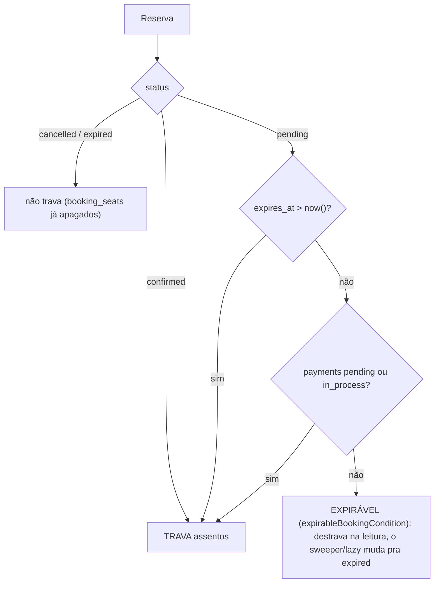
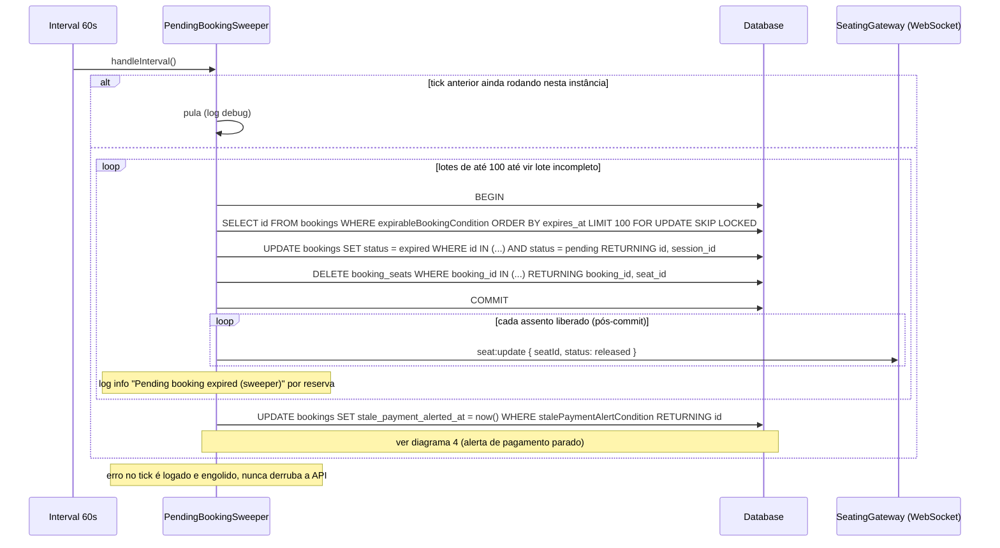
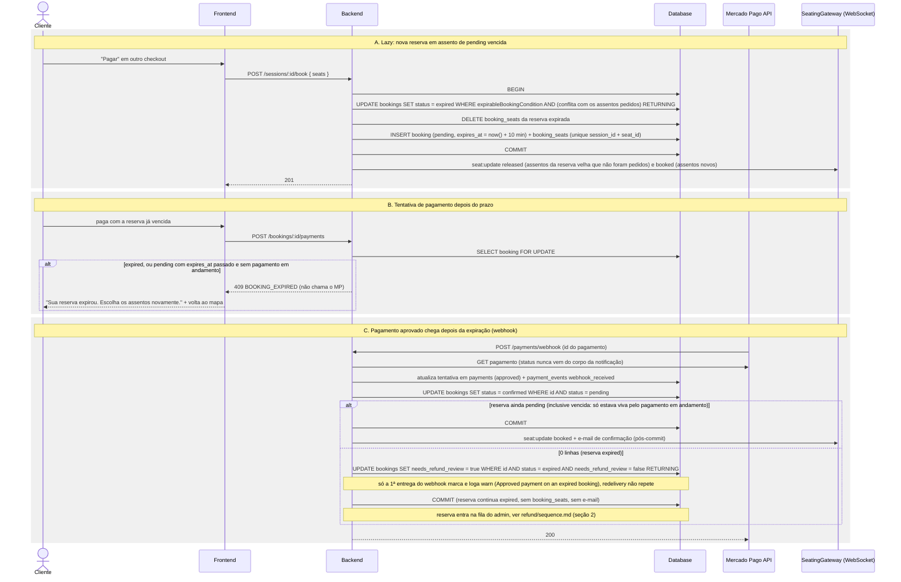
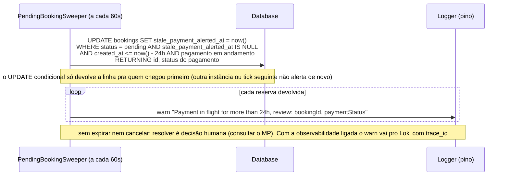

# Sequence: Expiração de reserva pendente

Como uma reserva `pending` deixa de travar assentos: o `PendingBookingSweeper` (a cada 60s), a expiração preguiçosa (lazy) numa nova reserva em conflito, a regra única de "ainda trava assento", o pagamento aprovado numa reserva já expirada (vai pra revisão de estorno) e o alerta de pagamento parado há mais de 24h. Spec: [`spec.md`](./spec.md). O estorno em si está em [`../refund/sequence.md`](../refund/sequence.md) e a criação da reserva em [`../booking/sequence.md`](../booking/sequence.md).

Constantes e condições SQL em `apps/api/src/booking/booking-lock.ts`: prazo de 10 min (`PENDING_BOOKING_TTL_MINUTES`), pagamento em andamento = `payments.status` em `pending`/`in_process`, alerta após 24h (`STALE_PAYMENT_ALERT_HOURS`). Todas as comparações de tempo usam o relógio do banco (`now()`), nunca o da instância da API.

## 1. Regra de trava (`activeBookingCondition`)

Uma reserva trava assentos quando é `confirmed`, ou `pending` e (ainda dentro do `expires_at` **ou** com pagamento em andamento). É a mesma regra do mapa de assentos, do hold, da criação de reserva e do sweeper.

## 2. Sweeper (a cada 60s)

`PendingBookingSweeper.handleInterval` (`@Interval(60_000)`). Só limpeza e UX: mapa, holds e criação de reserva já estão corretos sem ele, pela checagem lazy. Seguro com várias instâncias da API: `FOR UPDATE SKIP LOCKED` mais o `UPDATE ... WHERE status = 'pending'` expiram cada reserva uma única vez, e só quem expirou faz o broadcast.

## 3. Expiração lazy e pagamento depois do prazo

A reserva nova que conflita com uma `pending` vencida (sem pagamento em andamento) expira a velha na própria transação. Já o pagamento aprovado depois da expiração **não ressuscita** a reserva: o assento pode ser de outra pessoa a essa altura, então a reserva é marcada pra revisão de estorno.

## 4. Alerta de pagamento parado há mais de 24h

Pagamento `pending`/`in_process` segura a reserva além do prazo (a reserva não expira). Se passar de 24h, o sweeper registra um alerta uma única vez, sem mudar o status.

## Referências

- `apps/api/src/booking/pending-booking.sweeper.ts`, `apps/api/src/booking/booking-lock.ts`
- `apps/api/src/booking/booking.service.ts` (`createBookingForSeats` com expiração lazy, `confirmPaidBooking`, `flagExpiredBookingForRefundReview`)
- `apps/api/src/payment/payment.service.ts` (409 `BOOKING_EXPIRED`), `apps/api/src/booking/booking-expired.exception.ts`
- `apps/web/src/features/checkout/CheckoutPage.tsx` (aviso de reserva expirada)
