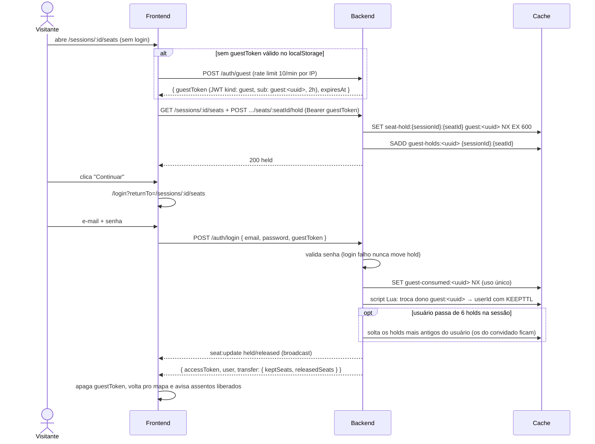

# Sequence: Convidado segura assento e transfere no login

Visitante sem login recebe uma identidade de convidado pra segurar assentos; ao fazer login, os holds passam pro usuário mantendo o TTL. Spec: [`spec.md`](./spec.md).

Token de convidado inválido, expirado ou já usado não bloqueia o login: a transferência é pulada e a resposta vem sem `transfer`. Token de convidado é recusado com 401 em booking, pagamento e ingressos (`JwtAuthGuard`).

## Referências

- `apps/api/src/auth/auth.controller.ts`, `apps/api/src/auth/auth.service.ts`, `apps/api/src/auth/user-or-guest-auth.guard.ts`
- `apps/api/src/seating/hold-transfer.service.ts`, `apps/api/src/seating/hold-keys.ts`
- `apps/web/src/lib/guest-token.ts`, `apps/web/src/features/auth/LoginPage.tsx`, `apps/web/src/features/seating/SessionSeatsPage.tsx`
