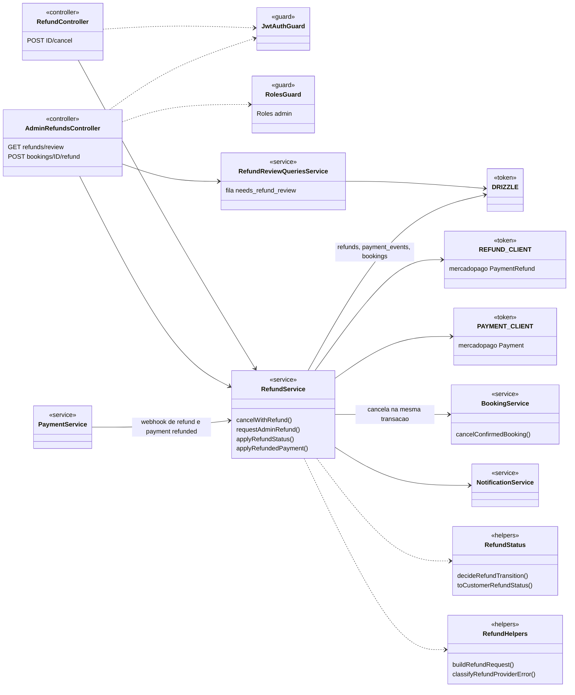

# Classes: Estorno de pagamento

Módulos `RefundModule` (`apps/api/src/refund/`) e a parte de estorno do `AdminModule` (`apps/api/src/admin/refunds/`). Spec: [`spec.md`](./spec.md); fluxos em [`sequence.md`](./sequence.md).

## Notas

- `RefundModule` importa `AuthTokenModule`, `BookingModule`, `NotificationModule` e `MercadoPagoModule`; exporta `RefundService`. `AdminModule` importa `RefundModule`.
- `RefundService` é o ponto único que muda `refunds`: usado pelo cliente (cancelar ingresso), pelo admin (fila de revisão) e pelo webhook (via `PaymentService`).
- A barreira contra estorno duplo é o índice único parcial `refunds_active_per_payment_uq` (ver [`../../schema.md`](../../schema.md)).
