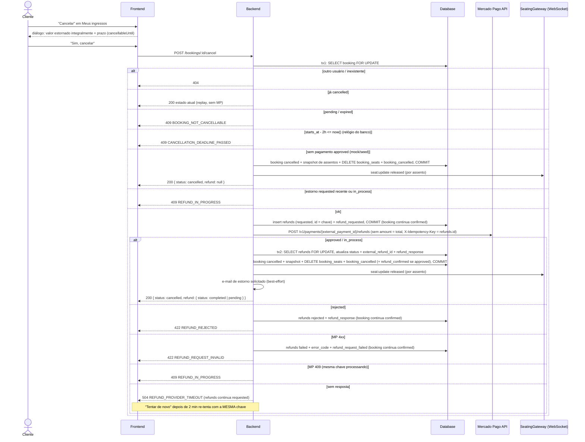
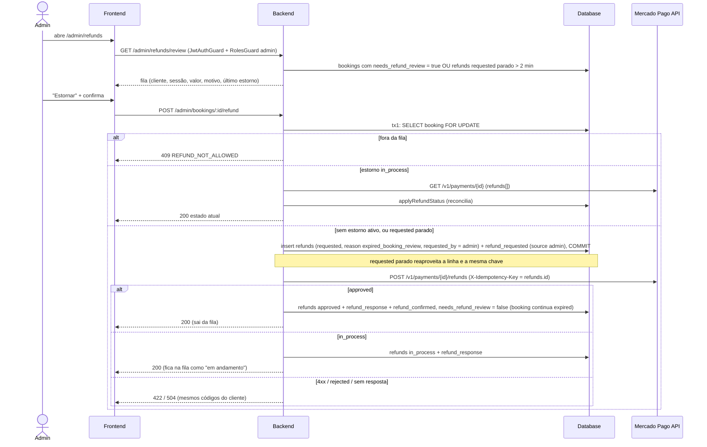
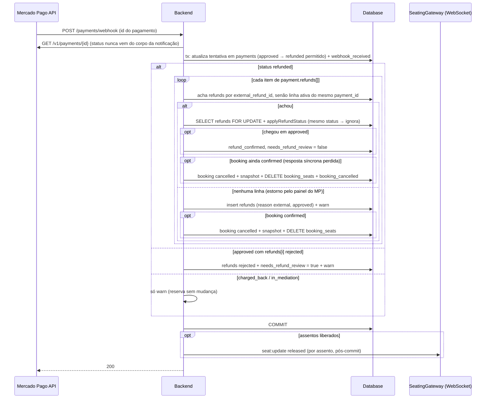

# Sequence: Estorno de pagamento

Cancelamento com estorno pelo cliente, estorno pela fila de revisão do admin e conclusão pelo webhook. Spec: [`spec.md`](./spec.md). Os diagramas usam os padrões recomendados das decisões em aberto (prazo de 2h, reserva continua `confirmed` se o estorno falha).

## 1. Cliente cancela ingresso pago

## 2. Admin estorna reserva da fila de revisão

## 3. Webhook de pagamento estornado

## Referências

- `apps/api/src/booking/booking-confirmation.controller.ts` (`POST /bookings/:id/cancel`, sai pro `RefundModule`)
- `apps/api/src/payment/payment.service.ts` (`handleWebhook`, `applyPaymentStatus`)
- `apps/api/src/payment/mercadopago.providers.ts` (`PAYMENT_CLIENT`; `REFUND_CLIENT` novo)
- `apps/web/src/features/tickets/TicketsPage.tsx`, `apps/web/src/features/admin/`
