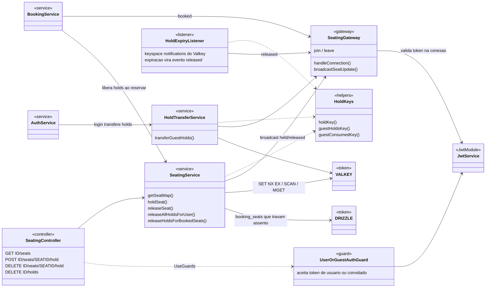

# Classes: Assentos (hold no Valkey + WebSocket)

Módulo `SeatingModule` (`apps/api/src/seating/`): mapa de assentos, hold temporário no Valkey (TTL de 600s), eventos em tempo real por WebSocket e transferência dos holds de convidado no login. Fluxos em [`../booking/sequence.md`](../booking/sequence.md) e [`../public-catalog-login-gate/sequence.md`](../public-catalog-login-gate/sequence.md).

## Notas

- `SeatingModule` importa só `AuthTokenModule` (e não `AuthModule`) pra evitar ciclo: `AuthModule` depende de `SeatingModule` por causa da transferência de holds no login.
- Exporta `SeatingGateway`, `SeatingService` e `HoldTransferService`.
- Chaves no Valkey: ver [`../../schema.md`](../../schema.md) ("Fora do Postgres").
