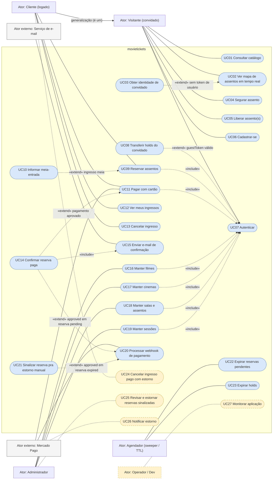

# Casos de uso

Visão funcional do sistema: quem usa o movietickets e pra quê. Complementa o C4 (`docs/c4/`), que mostra a estrutura técnica, e as specs por feature (`docs/flows/<feature>/spec.md`), que detalham as regras de cada caso de uso.

## Como abrir o diagrama

Diagrama UML: [`use-cases.drawio`](./use-cases.drawio) — abrir em [app.diagrams.net](https://app.diagrams.net) (File → Open From → Device) ou na extensão Draw.io do VS Code. O arquivo tem duas páginas (abas no rodapé):

- **Visitante e Cliente** — catálogo, mapa de assentos, hold, login, reserva, pagamento, ingressos.
- **Administrador e sistema** — painel admin, webhook do Mercado Pago, expiração de reservas e holds, monitoramento.

Legenda (também dentro do diagrama):

- Elipse azul, borda contínua: implementado.
- Elipse amarela, borda tracejada: planejado (Prova), spec sendo escrita em paralelo.
- `«include»`: o caso base sempre executa o incluído. `«extend»`: comportamento opcional, sob a condição entre colchetes; a seta sai da extensão e aponta pro caso base.
- Seta com triângulo vazado: generalização. Cliente é um Visitante, então herda todos os casos de uso dele.
- Ator cinza: sistema externo.

UC07 e UC14 aparecem nas duas páginas (mesmo caso de uso, desenhado de novo pra mostrar as relações de cada página).

## Aproximação em Mermaid

O GitHub não renderiza diagrama de casos de uso UML, então segue uma aproximação em flowchart (atores em retângulo, casos de uso em elipse/estádio, planejados tracejados). A fonte de verdade é o `.drawio`.

## Tabela de casos de uso

Specs: [catálogo público + login](../flows/public-catalog-login-gate/spec.md) (PCL), [expiração de reserva](../flows/pending-booking-expiry/spec.md) (PBE), [checkout transparente](../flows/checkout-transparente/spec.md) (CT), [painel admin](../flows/admin-panel/spec.md) (ADM). Fluxos sem spec própria (anteriores ao SDD) apontam pro `docs/planning.md` ou pro diagrama de sequência.

| ID | Caso de uso | Ator principal | Atores secundários | Descrição curta | Spec / AC | Status |
|---|---|---|---|---|---|---|
| UC01 | Consultar catálogo (filmes e sessões) | Visitante | — | Lista filmes com sessões futuras em `/movies`, sem login, com filtro por cidade e data (`GET /movies`). | [PCL](../flows/public-catalog-login-gate/spec.md) AC1; [ADM](../flows/admin-panel/spec.md) AC4 | implementado |
| UC02 | Ver mapa de assentos em tempo real | Visitante | — | Mostra livre/segurado/reservado por assento e recebe `seat:update` por WebSocket quando outro cliente segura, libera ou reserva. | [PCL](../flows/public-catalog-login-gate/spec.md) AC3, AC11, AC15; [PBE](../flows/pending-booking-expiry/spec.md) AC2, AC3, AC7 | implementado |
| UC03 | Obter identidade de convidado | Visitante | — | `«extend»` de UC02 quando não há token de usuário: `POST /auth/guest` emite JWT `kind: guest` (2h), reusado em reload e nova aba. | [PCL](../flows/public-catalog-login-gate/spec.md) AC2, AC15, AC16 | implementado |
| UC04 | Segurar assento (hold) | Visitante | — | `SETNX` no Valkey com TTL de 10 min, máximo 6 por sessão, recusa assento com reserva pendente dentro do prazo. | [PCL](../flows/public-catalog-login-gate/spec.md) AC3, AC4, AC12; [PBE](../flows/pending-booking-expiry/spec.md) AC4, AC7 | implementado |
| UC05 | Liberar assento(s) | Visitante | — | Desmarcar um assento solta o hold dele; sair do checkout solta todos os holds da sessão (`DELETE /sessions/:id/holds`). | `docs/planning.md` (feature 1) | implementado |
| UC06 | Cadastrar-se | Visitante | — | `POST /auth/register` cria usuário sempre com `role: "customer"`. | [ADM](../flows/admin-panel/spec.md) AC20 | implementado |
| UC07 | Autenticar (login) | Visitante | — | `POST /auth/login`. Exigido ao continuar pra reserva/pagamento (redireciona com `returnTo`) e na área `/admin` (role admin). | [PCL](../flows/public-catalog-login-gate/spec.md) AC5, AC8, AC9, AC14, AC17; [ADM](../flows/admin-panel/spec.md) AC1–AC3, AC21, AC22 | implementado |
| UC08 | Transferir holds do convidado | Visitante | — | `«extend»` de UC07 com `guestToken` válido: holds do convidado passam pro usuário mantendo o TTL; expirados ou acima do limite voltam em `transfer.releasedSeats`. | [PCL](../flows/public-catalog-login-gate/spec.md) AC6, AC7, AC10, AC13 | implementado |
| UC09 | Reservar assentos | Cliente | — | Cria reserva `pending` com prazo de 10 min (`POST /sessions/:id/book`), broadcast `booked`; retoma a reserva pendente do mesmo usuário em vez de duplicar. `«include»` UC07. | [PBE](../flows/pending-booking-expiry/spec.md) AC1, AC5, AC6, AC17; [CT](../flows/checkout-transparente/spec.md) AC6–AC8 | implementado |
| UC10 | Informar meia-entrada | Cliente | — | `«extend»` de UC09 por assento com `ticketType` meia: exige documento (`halfPriceDocument`) e cobra meio preço. | `docs/flows/booking/sequence.md` | implementado |
| UC11 | Pagar com cartão (checkout transparente) | Cliente | Mercado Pago | Resumo da reserva, campos seguros do SDK do Mercado Pago, token do cartão e `POST /bookings/:id/payments` com idempotência por `attemptId`. Recusado mantém a reserva pendente pra nova tentativa. `«include»` UC07. | [CT](../flows/checkout-transparente/spec.md) AC1–AC21; [PBE](../flows/pending-booking-expiry/spec.md) AC16 | implementado (sandbox) |
| UC12 | Ver meus ingressos | Cliente | — | Página `/tickets` com os ingressos confirmados do usuário (`GET /bookings/mine`). Requer login. | [PCL](../flows/public-catalog-login-gate/spec.md) AC2, AC8 | implementado |
| UC13 | Cancelar ingresso (sem estorno) | Cliente | — | `POST /bookings/:id/cancel` em reserva `confirmed`: vira `cancelled`, libera os assentos (broadcast `released`). Não estorna o pagamento. | `docs/planning.md` (feature 4) | implementado |
| UC14 | Confirmar reserva paga | Sistema (via UC11 ou UC20) | — | `«extend»` de UC11 e de UC20 quando o pagamento é `approved` numa reserva `pending`: confirma uma única vez, broadcast `booked` e e-mail. | [CT](../flows/checkout-transparente/spec.md) AC9, AC25, AC29; [PBE](../flows/pending-booking-expiry/spec.md) AC12 | implementado |
| UC15 | Enviar e-mail de confirmação | Sistema (via UC14) | Serviço de e-mail | `«include»` de UC14: envio síncrono e best-effort via SMTP (Mailpit em dev); falha só gera log. | [CT](../flows/checkout-transparente/spec.md) AC9, AC25; `docs/planning.md` (feature 6) | implementado (versão assíncrona não iniciada) |
| UC16 | Manter filmes | Administrador | — | CRUD em `/admin/movies` com validação; exclusão bloqueada se o filme tem sessão; mudança de duração não pode criar sobreposição. `«include»` UC07. | [ADM](../flows/admin-panel/spec.md) AC4–AC7, AC23, AC24 | implementado |
| UC17 | Manter cinemas | Administrador | — | Listar, criar e editar cinemas (sem exclusão). `«include»` UC07. | [ADM](../flows/admin-panel/spec.md) AC8 | implementado |
| UC18 | Manter salas e assentos | Administrador | — | CRUD de salas gerando `R × S` assentos; layout só muda sem sessões. `«include»` UC07. | [ADM](../flows/admin-panel/spec.md) AC9–AC11, AC19 | implementado |
| UC19 | Manter sessões | Administrador | — | CRUD de sessões sem sobreposição na sala, edição/exclusão bloqueadas com reserva, hold ativo ou sessão já iniciada; horário em `America/Sao_Paulo`. `«include»` UC07. | [ADM](../flows/admin-panel/spec.md) AC12–AC18, AC25 | implementado |
| UC20 | Processar webhook de pagamento | Mercado Pago | — | `POST /payments/webhook`: re-busca o pagamento na API do Mercado Pago, atualiza a tentativa, grava `payment_events` e aplica o status. | [CT](../flows/checkout-transparente/spec.md) AC22–AC28; [PBE](../flows/pending-booking-expiry/spec.md) AC12 | implementado (sandbox) |
| UC21 | Sinalizar reserva pra estorno manual | Sistema (via UC20) | — | `«extend»` de UC20 quando chega `approved` pra reserva `expired`: marca `needs_refund_review`, não ressuscita a reserva nem manda e-mail. | [PBE](../flows/pending-booking-expiry/spec.md) AC14; [CT](../flows/checkout-transparente/spec.md) AC27 | implementado |
| UC22 | Expirar reservas pendentes vencidas | Agendador | — | `PendingBookingSweeper` a cada 60s: `pending` vencida sem pagamento em andamento vira `expired`, assentos liberados com broadcast `released`; alerta pagamento parado há mais de 24h. | [PBE](../flows/pending-booking-expiry/spec.md) AC8–AC11, AC20 | implementado |
| UC23 | Expirar holds (TTL) | Agendador | — | TTL do Valkey derruba o hold; `HoldExpiryListener` (keyspace notifications) emite `released` pro mapa. | `docs/planning.md` (feature 1) | implementado |
| UC24 | Cancelar ingresso pago com estorno | Cliente | Mercado Pago | Cancelamento self-service que também estorna o pagamento no Mercado Pago (substitui UC13). | spec em andamento | planejado (Prova) |
| UC25 | Revisar e estornar reservas sinalizadas | Administrador | Mercado Pago | Admin vê as reservas com `needs_refund_review` (UC21) e dispara o estorno. | spec em andamento | planejado (Prova) |
| UC26 | Notificar estorno | Mercado Pago | — | Webhook de `refunded`/`charged_back` passa a atualizar a reserva (hoje só grava o status e loga, CT AC26). | spec em andamento | planejado (Prova) |
| UC27 | Monitorar aplicação (dashboards/alertas) | Operador / Dev | — | Dashboards e alertas de saúde da aplicação. | spec em andamento | planejado (Prova) |

## Manter este diagrama

Feature nova que adiciona ou muda um caso de uso atualiza as três coisas juntas: o `.drawio`, o Mermaid e a tabela. Caso planejado que for entregue troca de amarelo tracejado pra azul e ganha o link da spec com as ACs.
